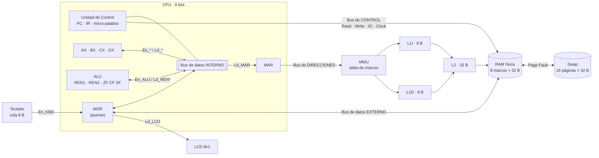
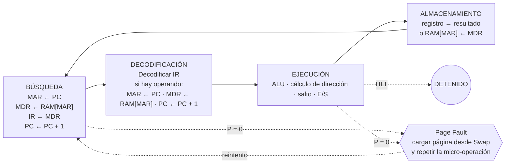

# Simulador de CPU · Arquitectura von Neumann de 8 bits

<p align="center">
  <br>
  <b>Equipo: Los Tigris</b>
</p>

<p align="center">🇪🇸 Español · 🇬🇧 <a href="README_EN.md">English</a></p>

Simulador interactivo de una CPU von Neumann de 8 bits construido en **Google Sheets + Google Apps Script**:
ciclo de instrucción completo con **micro-palabra de control**, **buses con buffers tri-estado**,
**memoria virtual** con Page Fault, **caché L1I / L1D / L2** y **teclado y LCD** mapeados en memoria.

- **Materia:** Arquitectura de Computadoras (SIS-131) · Universidad Católica Boliviana "San Pablo", Santa Cruz
- **Docente:** Ing. Paulo César Loayza Carrasco
- **Equipo:** Los Tigris
- **Estudiantes:**
- Adrian Rada
- Diego Andrade
- Daniel Roca

> 🔗 **Simulador:** [Abrir la hoja de cálculo](PEGA_AQUI_EL_ENLACE_DE_TU_HOJA) — el enlace final termina en `/copy`, así quien lo abre obtiene su propia copia con el script incluido.
>
> 📦 **Repositorio:** [https://github.com/Dieg0-andrade/Arquitectura-Computadoras-Parcial-2](https://github.com/Dieg0-andrade/Arquitectura-Computadoras-Parcial-2)

---

## Contenido

1. [Descripción](#1-descripción)
2. [Arquitectura](#2-arquitectura)
3. [Mapa de memoria](#3-mapa-de-memoria)
4. [Registros y banderas](#4-registros-y-banderas)
5. [Ciclo de instrucción](#5-ciclo-de-instrucción)
6. [Buses, buffers tri-estado y micro-palabra](#6-buses-buffers-tri-estado-y-micro-palabra)
7. [Conjunto de instrucciones (ISA)](#7-conjunto-de-instrucciones-isa)
8. [Memoria virtual](#8-memoria-virtual)
9. [Caché L1I / L1D / L2](#9-caché-l1i--l1d--l2)
10. [Periféricos de E/S](#10-periféricos-de-es)
11. [Ensamblador y compilador](#11-ensamblador-y-compilador)
12. [Manual de usuario](#12-manual-de-usuario)
13. [Programas](#13-programas)
14. [Pruebas](#14-pruebas)
15. [Estructura del código](#15-estructura-del-código)
16. [Decisiones de diseño](#16-decisiones-de-diseño)
17. [Gestión del proyecto y contribuciones](#17-gestión-del-proyecto-y-contribuciones)

---

## 1. Descripción

El simulador ejecuta programas escritos en un **lenguaje de alto nivel** (que se compila) o directamente en
**ensamblador**. Cada instrucción se descompone en **micro-operaciones** que se ejecutan una por una en las
cuatro fases del ciclo: **búsqueda → decodificación → ejecución → almacenamiento**. En cada micro-paso la
Unidad de Control emite una **micro-palabra** de 30 bits que decide qué buffers tri-estado conducen al bus.

```
alto nivel ──compilador──▶ ensamblador ──ensamblador──▶ código máquina en memoria virtual ──▶ ciclo de instrucción
                                                                     │
                                       CPU ──▶ MMU ──▶ L1I / L1D ──▶ L2 ──▶ RAM (8 marcos) ◀──▶ Swap (16 páginas)
```

| Requisito | Dónde está |
|---|---|
| Registros AX, BX, **CX, DX**, PC, IR, MAR, MDR, banderas ZF, CF, SF | Hoja **CPU** · `Registros.gs` |
| Buses de control, direcciones y datos; interno y externo | Hoja **Buses** · `Bus.gs` ([sección 6](#6-buses-buffers-tri-estado-y-micro-palabra)) |
| Buffers tri-estado (CONDUCE / HIGH-Z) y micro-palabra por paso | `MicroPalabra.gs`, `VistaBuses.gs`, hoja **Log** (columnas F y G) |
| Memoria virtual de 512 B, RAM de 256 B (8 marcos × 32 B), Page Fault y swap | Hojas **TablaMarcos**, **Swap**, **RAM** ([sección 8](#8-memoria-virtual)) |
| Caché L1I 8 B, L1D 8 B, L2 32 B con Hit/Miss y contadores | Hoja **Cache_IO** ([sección 9](#9-caché-l1i--l1d--l2)) |
| Teclado (cola de 8 B) y LCD 8x1 mapeados en memoria, `IN` / `OUT` | Hoja **Cache_IO** ([sección 10](#10-periféricos-de-es)) |
| Ciclo Fetch → Decode → Execute → Store, paso a paso y continuo | `UnidadControl.gs`, `MicroOperaciones.gs` |
| STEP / RUN / PAUSE / RESET | Controles de la hoja **CPU** (columna P), menú y panel lateral |
| Resaltado visual, log y leyenda de colores | `Resaltado.gs`, hoja **Log**, hojas **Inicio** y **CPU** |
| Nombre y logo del equipo | Hoja **Inicio** y este README |

---

## 2. Arquitectura



**Sigue siendo una arquitectura von Neumann:** código y datos comparten una sola memoria (virtual) y un solo
camino MAR/MDR. No se puede traer una instrucción y un dato a la vez: es el **cuello de botella de von Neumann**.
La caché separa L1I y L1D para aliviarlo, pero detrás de ellas hay una sola L2 y una sola RAM.

| Componente | Módulo | Responsable |
|---|---|---|
| Unidad de Control y micro-operaciones | `UnidadControl.gs`, `MicroOperaciones.gs` | Adrian |
| Micro-palabra y buses tri-estado | `MicroPalabra.gs`, `Bus.gs`, `VistaBuses.gs` | Adrian |
| Registros e ISA (CX, DX) | `Registros.gs`, `ISA.gs` | Adrian |
| Contrato único de memoria | `AccesoMemoria.gs` | Adrian (contrato) · Daniel (MMU) · Diego (caché) |
| MMU, tabla de marcos, Page Fault, reemplazo y swap | `MMU.gs`, `TablaMarcos.gs`, `ManejadorFallos.gs`, `Swap.gs` | Daniel |
| RAM en marcos | `VistaRam.gs`, `Memoria.gs` | Daniel |
| Caché L1I / L1D / L2 | `Cache.gs`, `VistaCache.gs`, `VistaCacheActividad.gs` | Diego |
| Teclado, LCD, `IN` / `OUT` | `Perifericos.gs` | Diego |
| ALU, ensamblador, compilador (Parcial 1) | `ALU.gs`, `Ensamblador*.gs`, `Compilador.gs` | Base del Parcial 1 |

---

## 3. Mapa de memoria

**Espacio virtual de 9 bits (000h–1FFh = 512 B, 16 páginas de 32 B)** y **RAM física de 256 B (8 marcos de 32 B)**.

| Dirección virtual | Páginas | Segmento | Notas |
|---|---|---|---|
| `000h – 0FFh` | 0 – 7 | Código | `PC` de 8 bits = dirección virtual de código |
| `100h – 1DFh` | 8 – 14 | Datos | Un operando `[dir]` de 8 bits apunta a `100h + dir` |
| `1E0h – 1EFh` | 15 | E/S (libre) | Página fija en el marco 7, sin caché |
| `1F0h – 1F7h` | 15 | E/S | Cola del **teclado** (8 B) |
| `1F8h – 1FFh` | 15 | E/S | Buffer del **LCD** (8 B) |

- **Traducción:** `VPN = dir >> 5`, `desplazamiento = dir & 31`, `dirFísica = PFN × 32 + desplazamiento`.
- La **página 15** (E/S) queda **fija en el marco 7**, nunca se desaloja y **no pasa por la caché**.
- Con la memoria virtual desactivada, la dirección física es la virtual (modo del Parcial 1: código `00h–7Fh`, datos `80h–FFh`).
- El **inspector** de la hoja RAM muestra cualquier dirección en hex, binario, decimal, segmento y mnemónico.

---

## 4. Registros y banderas

| Registro | Nombre en clase | Función |
|---|---|---|
| PC | C.P. | Dirección de la siguiente instrucción |
| IR | R.I. | Opcode de la instrucción en curso |
| MAR | RDM | Dirección que sale por el bus de direcciones |
| MDR | RIM | Dato que entra o sale por el bus de datos externo (puente entre los dos buses de datos) |
| AX | Acumulador | Propósito general / resultados |
| BX | — | Propósito general |
| **CX** | Contador | Propósito general · contador de bucles (`DEC CX` + `JNZ`) |
| **DX** | Datos | Propósito general · datos y E/S |
| REN1, REN2 | Entradas de la ALU | Operandos A y B |
| RESULTADO | Salida de la ALU | Resultado que vuelve al bus con `En_ALU` |

| Bandera | Se activa cuando… |
|---|---|
| **ZF** (cero) | el resultado de 8 bits es `00h` |
| **CF** (acarreo) | una suma pasa de `FFh`, o una resta necesita préstamo (a < b) |
| **SF** (signo) | el bit 7 del resultado es 1 (negativo en complemento a 2) |

---

## 5. Ciclo de instrucción



Cada micro-operación es un paso del reloj y tiene su **micro-palabra** ([sección 6](#6-buses-buffers-tri-estado-y-micro-palabra)).
Si la página no está en RAM, el manejador de fallos la trae desde el Swap y **repite la micro-operación que falló sin avanzar el PC**.

| Instrucción | Ejecución | Almacenamiento |
|---|---|---|
| `MOV r, inm` | — | `r ← MDR` |
| `MOV r1, r2` | — | `r1 ← r2` |
| `LOAD r, [dir]` | `MAR ← MDR` · `MDR ← RAM[MAR]` | `r ← MDR` |
| `STORE [dir], r` | `MAR ← MDR` · `MDR ← r` | `RAM[MAR] ← MDR` |
| `ADD r, x` | `REN1 ← r` · `REN2 ← x` · ALU | `r ← RESULTADO` |
| `CMP r, x` | `REN1 ← r` · `REN2 ← x` · ALU | (no guarda, solo banderas) |
| `IN r, [KBD]` | `MAR ← MDR` · `MDR ← KBD` | `r ← MDR` |
| `OUT [LCD], r` | `MAR ← MDR` · `MDR ← r` | `LCD ← MDR` |
| `JMP dir` | `PC ← MDR` | — |
| `JZ` / `JNZ dir` | `PC ← MDR` solo si ZF = 1 / 0 | — |
| `HLT` | detiene el reloj | — |

---

## 6. Buses, buffers tri-estado y micro-palabra

Detalle completo: [`docs/buses.md`](docs/buses.md) y [`docs/microword.md`](docs/microword.md).

### Buses

| Bus | Conecta | Quién lo maneja |
|---|---|---|
| **Datos interno** | PC, IR, MAR, MDR, AX, BX, CX, DX, REN1, REN2, ALU | el componente con `En_*` = 1 |
| **Datos externo** | MDR, RAM, teclado, LCD | RAM (`En_RAM`), teclado (`En_KBD`) o MDR (`En_MDR` + `Mem_W`) |
| **Direcciones** | MAR → MMU → caché / RAM o E/S | MAR, cuando hay `Mem_R` o `Mem_W` |
| **Control** | Unidad de Control → memoria y E/S | líneas `Read`, `Write`, `IO`, `Clock` |

El **MDR es el puente**: es el único registro conectado a los dos buses de datos. La RAM, el teclado y el LCD hablan con el CPU solo a través del MDR.

### Reglas tri-estado

- `En_X = 1` → el buffer de X **CONDUCE** (verde en la hoja Buses). `En_X = 0` → **HIGH-Z** (gris).
- `Ld_X = 1` → X **carga** el dato del bus (ámbar). Puede haber varios receptores a la vez.
- **Como máximo un `En_*` por micro-paso** (decisión D-8). Dos emisores = error y el CPU se detiene con `ERROR` **sin ejecutar el paso**.
- Emisor y receptores deben estar en el **mismo bus de datos**; entre bus interno y externo se pasa por el MDR.
- `Mem_R` y `Mem_W` nunca juntas; un registro no emite y carga en el mismo paso.

### Micro-palabra (30 bits)

26 señales de 1 bit + el campo `ALU_op` de 4 bits, en este orden (bit 29 a la izquierda):

| Bits | Señales |
|---|---|
| 29–27 | `En_PC` · `Ld_PC` · `Inc_PC` |
| 26–21 | `Ld_MAR` · `Mem_R` · `Mem_W` · `Ld_MDR` · `En_MDR` · `En_RAM` |
| 20–19 | `Ld_IR` · `En_IR` |
| 18–15 | `En_ALU` · `Ld_REN1` · `Ld_REN2` · `Ld_FLAGS` |
| 14–7 | `Ld_AX` · `En_AX` · `Ld_BX` · `En_BX` · `Ld_CX` · `En_CX` · `Ld_DX` · `En_DX` |
| 6–4 | `En_KBD` · `Ld_LCD` · `IO` |
| 3–0 | `ALU_op`: `0000` ninguna · `0001` ADD · `0010` SUB · `0011` INC · `0100` DEC · `0101` CMP · `0110` AND · `0111` OR · `1000` XOR · `1001` NOT |

**Ejemplo: fase de búsqueda**

| Micro-operación | Señales en 1 | Bus activo | Conducen |
|---|---|---|---|
| `MAR ← PC` | `En_PC` `Ld_MAR` | interno: PC → MAR | PC |
| `MDR ← RAM[MAR]` | `Mem_R` `En_RAM` `Ld_MDR` | externo: RAM → MDR | RAM, MAR (direcciones) |
| `IR ← MDR` | `En_MDR` `Ld_IR` | interno: MDR → IR | MDR |
| `PC ← PC + 1` | `Inc_PC` | ninguno (todo en HIGH-Z) | — |

`MAR ← PC` en bits: `1001 0000 0000 0000 0000 0000 0000 00`. La hoja **Log** muestra la micro-palabra y sus bits
en cada paso, y la hoja **Buses** la dibuja con los buffers en verde o gris.

---

## 7. Conjunto de instrucciones (ISA)

- **100 instrucciones** de 1 o 2 bytes: 36 del Parcial 1 (AX, BX), 56 con **CX y DX** y 8 de **E/S**.
- Opcodes: `0x` control · `1x` transferencia · `2x` aritmética · `3x` lógica · `4x` saltos · `5x` **E/S** ·
  `6x` INC/DEC y operaciones con inmediato de CX/DX · `7x`–`Ax` MOV/ADD/SUB/CMP entre registros (`base + 4·destino + origen`, con AX = 0, BX = 1, CX = 2, DX = 3).
- Modos de direccionamiento: implícito, registro, inmediato (`inm`), directo (`[dir]`), absoluto (`dir`) y E/S.
- La misma tabla está en la hoja **ISA** (se genera desde `ISA.gs`, que es la única fuente de verdad). Detalle de CX/DX: [`docs/isa-cx-dx.md`](docs/isa-cx-dx.md).

<details>
<summary><b>Tabla completa (100 instrucciones)</b></summary>

| Opcode | Mnemónico | Operandos | Bytes | Modo | Descripción |
|---|---|---|---|---|---|
| `00h` | HLT | — | 1 | implícito | Detiene el reloj del CPU |
| `10h` | MOV | AX, inm | 2 | inmediato | AX ← dato inmediato |
| `11h` | MOV | BX, inm | 2 | inmediato | BX ← dato inmediato |
| `12h` | MOV | AX, BX | 1 | registro | AX ← BX |
| `13h` | MOV | BX, AX | 1 | registro | BX ← AX |
| `14h` | LOAD | AX, [dir] | 2 | directo | AX ← RAM[dir] |
| `15h` | LOAD | BX, [dir] | 2 | directo | BX ← RAM[dir] |
| `16h` | STORE | [dir], AX | 2 | directo | RAM[dir] ← AX |
| `17h` | STORE | [dir], BX | 2 | directo | RAM[dir] ← BX |
| `18h` | MOV | CX, inm | 2 | inmediato | CX ← dato inmediato |
| `19h` | MOV | DX, inm | 2 | inmediato | DX ← dato inmediato |
| `1Ah` | LOAD | CX, [dir] | 2 | directo | CX ← RAM[dir] |
| `1Bh` | LOAD | DX, [dir] | 2 | directo | DX ← RAM[dir] |
| `1Ch` | STORE | [dir], CX | 2 | directo | RAM[dir] ← CX |
| `1Dh` | STORE | [dir], DX | 2 | directo | RAM[dir] ← DX |
| `20h` | ADD | AX, inm | 2 | inmediato | AX ← AX + inm |
| `21h` | ADD | AX, BX | 1 | registro | AX ← AX + BX |
| `22h` | ADD | BX, inm | 2 | inmediato | BX ← BX + inm |
| `23h` | ADD | BX, AX | 1 | registro | BX ← BX + AX |
| `24h` | SUB | AX, inm | 2 | inmediato | AX ← AX − inm |
| `25h` | SUB | AX, BX | 1 | registro | AX ← AX − BX |
| `26h` | SUB | BX, inm | 2 | inmediato | BX ← BX − inm |
| `27h` | SUB | BX, AX | 1 | registro | BX ← BX − AX |
| `28h` | INC | AX | 1 | registro | AX ← AX + 1 |
| `29h` | INC | BX | 1 | registro | BX ← BX + 1 |
| `2Ah` | DEC | AX | 1 | registro | AX ← AX − 1 |
| `2Bh` | DEC | BX | 1 | registro | BX ← BX − 1 |
| `2Ch` | CMP | AX, inm | 2 | inmediato | Banderas de AX − inm (no guarda) |
| `2Dh` | CMP | AX, BX | 1 | registro | Banderas de AX − BX (no guarda) |
| `2Eh` | CMP | BX, inm | 2 | inmediato | Banderas de BX − inm (no guarda) |
| `2Fh` | CMP | BX, AX | 1 | registro | Banderas de BX − AX (no guarda) |
| `30h` | AND | AX, inm | 2 | inmediato | AX ← AX AND inm |
| `31h` | AND | AX, BX | 1 | registro | AX ← AX AND BX |
| `32h` | OR | AX, inm | 2 | inmediato | AX ← AX OR inm |
| `33h` | OR | AX, BX | 1 | registro | AX ← AX OR BX |
| `34h` | XOR | AX, inm | 2 | inmediato | AX ← AX XOR inm |
| `35h` | XOR | AX, BX | 1 | registro | AX ← AX XOR BX |
| `36h` | NOT | AX | 1 | registro | AX ← NOT AX |
| `37h` | NOT | BX | 1 | registro | BX ← NOT BX |
| `40h` | JMP | dir | 2 | absoluto | PC ← dir (salto incondicional) |
| `41h` | JZ | dir | 2 | absoluto | Si ZF = 1: PC ← dir |
| `42h` | JNZ | dir | 2 | absoluto | Si ZF = 0: PC ← dir |
| `50h` | IN | AX, [KBD] | 2 | E/S | Leer un byte del teclado en AX |
| `51h` | IN | BX, [KBD] | 2 | E/S | Leer un byte del teclado en BX |
| `52h` | IN | CX, [KBD] | 2 | E/S | Leer un byte del teclado en CX |
| `53h` | IN | DX, [KBD] | 2 | E/S | Leer un byte del teclado en DX |
| `54h` | OUT | [LCD], AX | 2 | E/S | Enviar AX al LCD |
| `55h` | OUT | [LCD], BX | 2 | E/S | Enviar BX al LCD |
| `56h` | OUT | [LCD], CX | 2 | E/S | Enviar CX al LCD |
| `57h` | OUT | [LCD], DX | 2 | E/S | Enviar DX al LCD |
| `60h` | INC | CX | 1 | registro | CX ← CX + 1 |
| `61h` | INC | DX | 1 | registro | DX ← DX + 1 |
| `62h` | DEC | CX | 1 | registro | CX ← CX − 1 |
| `63h` | DEC | DX | 1 | registro | DX ← DX − 1 |
| `64h` | ADD | CX, inm | 2 | inmediato | CX ← CX + inm |
| `65h` | ADD | DX, inm | 2 | inmediato | DX ← DX + inm |
| `66h` | SUB | CX, inm | 2 | inmediato | CX ← CX − inm |
| `67h` | SUB | DX, inm | 2 | inmediato | DX ← DX − inm |
| `68h` | CMP | CX, inm | 2 | inmediato | Banderas de CX − inm (no guarda) |
| `69h` | CMP | DX, inm | 2 | inmediato | Banderas de DX − inm (no guarda) |
| `72h` | MOV | AX, CX | 1 | registro | AX ← CX |
| `73h` | MOV | AX, DX | 1 | registro | AX ← DX |
| `76h` | MOV | BX, CX | 1 | registro | BX ← CX |
| `77h` | MOV | BX, DX | 1 | registro | BX ← DX |
| `78h` | MOV | CX, AX | 1 | registro | CX ← AX |
| `79h` | MOV | CX, BX | 1 | registro | CX ← BX |
| `7Bh` | MOV | CX, DX | 1 | registro | CX ← DX |
| `7Ch` | MOV | DX, AX | 1 | registro | DX ← AX |
| `7Dh` | MOV | DX, BX | 1 | registro | DX ← BX |
| `7Eh` | MOV | DX, CX | 1 | registro | DX ← CX |
| `82h` | ADD | AX, CX | 1 | registro | AX ← AX + CX |
| `83h` | ADD | AX, DX | 1 | registro | AX ← AX + DX |
| `86h` | ADD | BX, CX | 1 | registro | BX ← BX + CX |
| `87h` | ADD | BX, DX | 1 | registro | BX ← BX + DX |
| `88h` | ADD | CX, AX | 1 | registro | CX ← CX + AX |
| `89h` | ADD | CX, BX | 1 | registro | CX ← CX + BX |
| `8Bh` | ADD | CX, DX | 1 | registro | CX ← CX + DX |
| `8Ch` | ADD | DX, AX | 1 | registro | DX ← DX + AX |
| `8Dh` | ADD | DX, BX | 1 | registro | DX ← DX + BX |
| `8Eh` | ADD | DX, CX | 1 | registro | DX ← DX + CX |
| `92h` | SUB | AX, CX | 1 | registro | AX ← AX − CX |
| `93h` | SUB | AX, DX | 1 | registro | AX ← AX − DX |
| `96h` | SUB | BX, CX | 1 | registro | BX ← BX − CX |
| `97h` | SUB | BX, DX | 1 | registro | BX ← BX − DX |
| `98h` | SUB | CX, AX | 1 | registro | CX ← CX − AX |
| `99h` | SUB | CX, BX | 1 | registro | CX ← CX − BX |
| `9Bh` | SUB | CX, DX | 1 | registro | CX ← CX − DX |
| `9Ch` | SUB | DX, AX | 1 | registro | DX ← DX − AX |
| `9Dh` | SUB | DX, BX | 1 | registro | DX ← DX − BX |
| `9Eh` | SUB | DX, CX | 1 | registro | DX ← DX − CX |
| `A2h` | CMP | AX, CX | 1 | registro | Banderas de AX − CX (no guarda) |
| `A3h` | CMP | AX, DX | 1 | registro | Banderas de AX − DX (no guarda) |
| `A6h` | CMP | BX, CX | 1 | registro | Banderas de BX − CX (no guarda) |
| `A7h` | CMP | BX, DX | 1 | registro | Banderas de BX − DX (no guarda) |
| `A8h` | CMP | CX, AX | 1 | registro | Banderas de CX − AX (no guarda) |
| `A9h` | CMP | CX, BX | 1 | registro | Banderas de CX − BX (no guarda) |
| `ABh` | CMP | CX, DX | 1 | registro | Banderas de CX − DX (no guarda) |
| `ACh` | CMP | DX, AX | 1 | registro | Banderas de DX − AX (no guarda) |
| `ADh` | CMP | DX, BX | 1 | registro | Banderas de DX − BX (no guarda) |
| `AEh` | CMP | DX, CX | 1 | registro | Banderas de DX − CX (no guarda) |
</details>

---

## 8. Memoria virtual

> **Documentación técnica** (Daniel Roca): [Memoria virtual (ES)](docs/memoria-virtual.md) · [Virtual memory (EN)](docs/virtual-memory.md) · [Resultados de pruebas](docs/testing.md).

- **512 B virtuales** (16 páginas de 32 B) sobre **256 B de RAM** (8 marcos de 32 B). La hoja **Swap** guarda las 16 páginas (es el "disco").
- **Tabla de marcos** (hoja **TablaMarcos**): una fila por página con `VPN`, `P` (presente), `PFN`, `Dirty` y `Ref`.
- **Traducción** (`MMU.traducir`): `VPN = dir >> 5`, `offset = dir & 31`, `física = PFN × 32 + offset`. El panel muestra la última traducción y el Log guarda las 10 más recientes.
- **Page Fault:** si `P = 0`, la entrada se resalta en rojo, se busca un marco libre (o una víctima), se copian 32 B desde el Swap, se pone `P = 1` y se **repite la micro-operación** (decisión D-7).
- **Reemplazo FIFO o LRU** (seleccionable en la hoja TablaMarcos). Si la víctima tiene `Dirty = 1`, se escribe en el Swap antes de reemplazarla, y se invalida su caché. La página 15 (E/S) nunca se desaloja.
- **Contadores** de fallos y desalojos.

---

## 9. Caché L1I / L1D / L2

> **Documentación técnica** (Diego Andrade): [Caché, E/S y catálogo](docs/cache-io.md).

- **Orden de acceso:** CPU → MMU → L1I (instrucciones) o L1D (datos) → L2 → RAM. La caché trabaja con **direcciones físicas**.
- **L1I y L1D:** una línea de 8 B cada una. **L2:** 32 B (4 líneas de 8 B), compartida.
- Política de escritura **write-through** con **write-allocate**: se actualizan la RAM y las copias del dato en L1I, L1D y L2.
- Un hit en L1 no cuenta en L2. **Hit Rate** = hits / (hits + misses), 0 si todavía no hubo accesos.
- **Contadores** de hits y misses por nivel y **Hit Rate**. Cada acceso se pinta en verde (hit) o rojo (miss) en la hoja **Cache_IO** y se anota en el Log.
- Los accesos a la página 15 (E/S) **no pasan por la caché**. Cargar un programa o desalojar una página invalida las líneas afectadas.

---

## 10. Periféricos de E/S

> **Documentación técnica** (Diego Andrade): [Caché, E/S y catálogo](docs/cache-io.md).

| Dispositivo | Dirección virtual | Dirección física | Instrucción | Micro-palabra |
|---|---|---|---|---|
| **Teclado** (cola FIFO circular de 8 B) | `1F0h – 1F7h` | `F0h – F7h` | `IN r, [KBD]` | `IO` `Mem_R` `En_KBD` `Ld_MDR` |
| **LCD 8x1** (buffer de 8 B) | `1F8h – 1FFh` | `F8h – FFh` | `OUT [LCD], r` | `IO` `Mem_W` `En_MDR` `Ld_LCD` |

- En la hoja **Cache_IO** se escribe un carácter en la celda **C33** y queda en la cola (se ve en `B31:I31`, en orden de salida); `IN` saca el byte más antiguo. Con la cola llena se rechaza la entrada; leerla vacía devuelve 0.
- El LCD se ve en `Cache_IO!K31:R31`; los códigos ASCII 32–126 se muestran como caracteres.
- `OUT` escribe un byte en el buffer del LCD y la pantalla de 8 caracteres se refresca.
- Los dos usan el bus externo con la señal `IO = 1` y siempre pasan por el MDR.

```asm
.code
IN  AX, [KBD]     ; AX ← carácter de la cola del teclado
OUT [LCD], AX     ; eco en el LCD
HLT
```

---

## 11. Ensamblador y compilador


**Sintaxis**

```asm
.data                   ; segmento de datos (desde 80h)
x      DB 5             ; variable de 1 byte
.code                   ; segmento de código (desde 00h)
bucle: LOAD AX, [x]     ; etiqueta + instrucción; [x] = dirección de memoria
       ADD AX, 0Fh      ; números: 15, 0x0F o 0Fh
       JNZ bucle        ; los saltos usan etiquetas
       HLT
```

- **1ª pasada:** calcula la dirección de cada instrucción y variable. Hace falta porque un salto puede usar una etiqueta que se define más abajo.
- **2ª pasada:** genera los bytes con la tabla ISA y reemplaza cada símbolo por su dirección.
- **Errores** con número de línea (mnemónico desconocido, operandos inválidos, símbolo no definido, duplicado, número fuera de 8 bits, segmento lleno). Se marcan en rojo en la hoja Código y el programa no se carga.

### Compilador de alto nivel

```text
// comentario
var a = 5                 // declaración: variable en el segmento de datos
var b = 3
var res = 0
mientras b != 0 {         // bucle
  res = res + a           // asignación con + y -
  b = b - 1
}
si res == 15 {            // condicional
  res = res + 0
}
```

**Gramática**

```text
programa   := sentencia*
sentencia  := 'var' ID '=' NUM | ID '=' expresion
            | 'mientras' condicion '{' sentencia* '}' | 'si' condicion '{' sentencia* '}'
expresion  := termino (('+' | '-') termino)*
condicion  := expresion ('==' | '!=') termino
termino    := NUM | ID
```

Solo hay `==` y `!=` porque la ISA tiene `JZ` y `JNZ`, que dependen únicamente de ZF.

**Etapas** (visibles en la hoja **Compilador**): tokens → **AST** (árbol indentado) → **ensamblador generado**
(con `; Ln:` indicando la línea de origen) → tabla de símbolos → código máquina.

| Construcción | Ensamblador generado (AX acumulador, BX temporal) |
|---|---|
| `x = a + 3` | `LOAD AX, [a]` · `ADD AX, 3` · `STORE [x], AX` |
| `x = a - b` | `LOAD AX, [a]` · `LOAD BX, [b]` · `SUB AX, BX` · `STORE [x], AX` |
| `mientras c != v { … }` | `_mN: …CMP` · `JZ _fN` · cuerpo · `JMP _mN` · `_fN:` |
| `si c == v { … }` | `…CMP` · `JNZ _sN` · cuerpo · `_sN:` |

**Traza:** mientras se ejecuta, la hoja Código resalta en ámbar la **línea de ensamblador** y la **línea de alto
nivel** de la instrucción en curso (sigue los saltos).

---

## 12. Manual de usuario

### Instalación
1. En la raíz del repo: `node herramientas/construir.js` → genera `dist/SimuladorCompleto.gs` y `dist/Panel.html`.
2. Crear una hoja de Google Sheets (región **Estados Unidos** en *Archivo → Configuración*) → **Extensiones → Apps Script**.
3. Pegar `dist/SimuladorCompleto.gs`; para el panel lateral, crear un archivo HTML llamado **`Panel`** y pegar `dist/Panel.html`.
4. Recargar la hoja → menú **Simulador CPU → Preparar libro** → aceptar permisos.

O, más fácil: abrir el **enlace de la hoja** de arriba (termina en `/copy`) y hacer una copia, que ya trae el script.

### Uso con los controles de la hoja CPU

En la hoja **CPU**, columna **P**, cada control es una casilla: al marcarla se ejecuta la acción y la casilla se desmarca sola.

| Control | Acción |
|---|---|
| ★ CARGAR DEMO | Escribe el demo de alto nivel en la hoja Código, lo compila y lo carga |
| ⚙ COMPILAR (col. B) | Compila el programa de alto nivel de la hoja Código |
| ⤓ ENSAMBLAR (col. E) | Ensambla el programa en ensamblador de la hoja Código |
| ▶\| PASO | Ejecuta una micro-operación |
| ⏭ INSTRUCCIÓN | Ejecuta la instrucción completa |
| ▶ EJECUTAR | Ejecución continua, instrucción por instrucción, con el **Retardo (ms)** configurable |
| ❚❚ PAUSA | Detiene EJECUTAR al terminar la instrucción actual (se puede continuar) |
| ↺ REINICIAR | Registros, banderas, log, colores y buses en cero (la RAM se mantiene) |

Los mismos comandos están en el menú **Simulador CPU** y en el panel lateral (**Simulador CPU → Abrir panel de control**).

### Hojas del libro

| Hoja | Qué muestra |
|---|---|
| **Inicio** | Portada: logo, equipo, guía de controles y leyenda de colores |
| **CPU** | Registros, fase, micro-operación, últimas 10 micro-operaciones y controles |
| **Buses** | Buffers tri-estado, buses interno / externo / direcciones / control y los 30 bits de la micro-palabra |
| **RAM** | Memoria física en 8 marcos de 32 B + inspector |
| **Código** | Programa en alto nivel (col. B) y en ensamblador (col. E), con la línea en ejecución resaltada |
| **Compilador** | Tokens, AST, ensamblador generado, símbolos y código máquina |
| **Log** | `[Paso NN]` · instrucción · fase · micro-operación · detalle · **micro-palabra** · **bits** |
| **ISA** | Las 100 instrucciones |
| **Cache_IO** | L1I, L1D, L2, contadores y Hit Rate, teclado y LCD |
| **Swap** | Las 16 páginas virtuales de 32 B |
| **TablaMarcos** | Tabla de páginas (P, PFN, Dirty, Ref), última traducción, FIFO / LRU y contadores de fallos |
| **Programas** | Catálogo de los 3 programas: selección, carga y verificación del resultado |

### Leyenda de colores
La misma leyenda está en la hoja **Inicio** y, compacta, en la hoja **CPU** debajo de los controles.

| Color | Significado |
|---|---|
| 🟨 Ámbar | Destino de la transferencia · componente que carga (`Ld_*`) · bit de la micro-palabra en 1 |
| 🟦 Celeste | Origen de la transferencia |
| 🟩 Verde | Buffer tri-estado que **conduce** · bus activo |
| ⬜ Gris | Buffer en **HIGH-Z** · bus o componente en reposo |
| 🟢 Verde claro | Hit de caché |
| 🟥 Rojo claro | Miss de caché · Page Fault |
| Azul claro / verde menta | Segmento de código / de datos en la RAM |
| Crema | Celda editable (entrada del usuario) |

### Menú Simulador CPU
| Opción | Acción |
|---|---|
| Preparar libro | Construye (o reconstruye) todas las hojas |
| Cargar programa demo / demo de alto nivel | Escribe el demo en la hoja Código y lo carga |
| Compilar alto nivel y cargar · Ensamblar y cargar programa | Carga lo que esté escrito en la hoja Código |
| Paso / Ejecutar instrucción / Ejecutar hasta HLT | Ejecución por micro-operación, por instrucción o completa |
| Reiniciar CPU · Limpiar RAM | Vuelven el CPU o la RAM a cero |
| Pruebas → Ejecutar todas | Corre todas las pruebas automáticas ([sección 14](#14-pruebas)) |

---

## 13. Programas

### Catálogo de programas

Hoja **Programas** (menú **Simulador CPU → Abrir catalogo de programas**): se elige el programa en `B3`, se carga con **Cargar programa del catalogo**, se ejecuta con los controles y se comprueba con **Verificar resultado del catalogo**. Detalle en [`docs/cache-io.md`](docs/cache-io.md).

| # | Programa | Qué hace | Resultado esperado |
|---|---|---|---|
| 1 | **Bucle aritmetico AX-DX** | Suma 4 tres veces: AX acumula, BX vale 4, CX cuenta las vueltas (`DEC CX` + `JNZ`) y DX guarda el resultado | HLT · AX = 12, BX = 4, CX = 0, DX = 12 |
| 2 | **Eco teclado-LCD** | `IN AX, [KBD]` lee la letra ingresada en `Cache_IO!C33` y `OUT [LCD], AX` la muestra en la primera posición del LCD | HLT · AX = código ASCII · el LCD muestra la letra |
| 3 | **Accesos dispersos** | Suma datos repartidos en 7 páginas; la página de `p6` empieza ausente | HLT · AX = 28 · Page Faults > 0 · misses en L1D y L2 > 0 |

### Editor de ensamblador

Menú **Simulador CPU → Abrir editor de ensamblador**: se escribe el programa en la hoja **Código**, **Validar sintaxis del editor** marca la línea con error, y **Cargar editor en memoria virtual** lo ensambla y lo carga en las páginas virtuales.

### Programa demostrativo del Parcial 1 y traza

**Multiplicación por sumas sucesivas:** `res = a × b` sumando `a` tantas veces como indica `b`.
Usa un bucle (`JMP`), una bifurcación condicional (`CMP` + `JZ`), lectura/escritura en memoria y `HLT`.

```asm
; Multiplicación por sumas sucesivas: res = a × b
; Resultado esperado: RAM[82h] = 0Fh (15)
.data
a      DB 5           ; multiplicando          -> 80h
b      DB 3           ; multiplicador/contador -> 81h
res    DB 0           ; resultado              -> 82h
.code
       MOV AX, 0      ; res = 0
       STORE [res], AX
bucle: LOAD BX, [b]   ; ¿quedan vueltas?
       CMP BX, 0
       JZ fin         ; si b = 0 terminar
       DEC BX         ; b = b - 1
       STORE [b], BX
       LOAD AX, [res] ; res = res + a
       LOAD BX, [a]
       ADD AX, BX
       STORE [res], AX
       JMP bucle
fin:   HLT
```

### Versión en alto nivel

El mismo programa en el lenguaje de alto nivel (**★ DEMO ALTO NIVEL**) se compila a 18 líneas de ensamblador
(22 bytes) y da el mismo resultado:

```text
var a = 5
var b = 3
var res = 0
mientras b != 0 {
  res = res + a
  b = b - 1
}
```

```asm
_m1:  LOAD AX, [b]      ; L5: mientras b != 0 {
      CMP AX, 0
      JZ _f1
      LOAD AX, [res]    ; L6: res = res + a
      LOAD BX, [a]
      ADD AX, BX
      STORE [res], AX
      LOAD AX, [b]      ; L7: b = b - 1
      SUB AX, 1
      STORE [b], AX
      JMP _m1
_f1:
      HLT
```

### Código máquina generado (versión en ensamblador)

| Dirección | Bytes | Fuente |
|---|---|---|
| 00h | `10 00` | `MOV AX, 0` |
| 02h | `16 82` | `STORE [res], AX` |
| 04h | `15 81` | `bucle: LOAD BX, [b]` |
| 06h | `2E 00` | `CMP BX, 0` |
| 08h | `41 16` | `JZ fin` |
| 0Ah | `2B` | `DEC BX` |
| 0Bh | `17 81` | `STORE [b], BX` |
| 0Dh | `14 82` | `LOAD AX, [res]` |
| 0Fh | `15 80` | `LOAD BX, [a]` |
| 11h | `21` | `ADD AX, BX` |
| 12h | `16 82` | `STORE [res], AX` |
| 14h | `40 04` | `JMP bucle` |
| 16h | `00` | `fin: HLT` |
| 80h | `05` | `a DB 5` |
| 81h | `03` | `b DB 3` |
| 82h | `00` | `res DB 0` |

| Símbolo | Tipo | Dirección |
|---|---|---|
| `a` | variable | 80h |
| `b` | variable | 81h |
| `res` | variable | 82h |
| `bucle` | etiqueta | 04h |
| `fin` | etiqueta | 16h |

### Traza de registros (una fila por instrucción, valores al terminarla)

| # | PC inicial | Instrucción | Micro-ops | PC | AX | BX | ZF CF SF | RAM[81h] (b) | RAM[82h] (res) |
|---|---|---|---|---|---|---|---|---|---|
| 1 | 00h | `MOV AX, 00h` | 10 | 02h | 00h | 00h | 0 0 0 | 03h | 00h |
| 2 | 02h | `STORE [82h], AX` | 11 | 04h | 00h | 00h | 0 0 0 | 03h | 00h |
| 3 | 04h | `LOAD BX, [81h]` | 11 | 06h | 00h | 03h | 0 0 0 | 03h | 00h |
| 4 | 06h | `CMP BX, 00h` | 12 | 08h | 00h | 03h | 0 0 0 | 03h | 00h |
| 5 | 08h | `JZ 16h` | 9 | 0Ah | 00h | 03h | 0 0 0 | 03h | 00h |
| 6 | 0Ah | `DEC BX` | 8 | 0Bh | 00h | 02h | 0 0 0 | 03h | 00h |
| 7 | 0Bh | `STORE [81h], BX` | 11 | 0Dh | 00h | 02h | 0 0 0 | 02h | 00h |
| 8 | 0Dh | `LOAD AX, [82h]` | 11 | 0Fh | 00h | 02h | 0 0 0 | 02h | 00h |
| 9 | 0Fh | `LOAD BX, [80h]` | 11 | 11h | 00h | 05h | 0 0 0 | 02h | 00h |
| 10 | 11h | `ADD AX, BX` | 9 | 12h | 05h | 05h | 0 0 0 | 02h | 00h |
| 11 | 12h | `STORE [82h], AX` | 11 | 14h | 05h | 05h | 0 0 0 | 02h | 05h |
| 12 | 14h | `JMP 04h` | 9 | 04h | 05h | 05h | 0 0 0 | 02h | 05h |
| 13 | 04h | `LOAD BX, [81h]` | 11 | 06h | 05h | 02h | 0 0 0 | 02h | 05h |
| 14 | 06h | `CMP BX, 00h` | 12 | 08h | 05h | 02h | 0 0 0 | 02h | 05h |
| 15 | 08h | `JZ 16h` | 9 | 0Ah | 05h | 02h | 0 0 0 | 02h | 05h |
| 16 | 0Ah | `DEC BX` | 8 | 0Bh | 05h | 01h | 0 0 0 | 02h | 05h |
| 17 | 0Bh | `STORE [81h], BX` | 11 | 0Dh | 05h | 01h | 0 0 0 | 01h | 05h |
| 18 | 0Dh | `LOAD AX, [82h]` | 11 | 0Fh | 05h | 01h | 0 0 0 | 01h | 05h |
| 19 | 0Fh | `LOAD BX, [80h]` | 11 | 11h | 05h | 05h | 0 0 0 | 01h | 05h |
| 20 | 11h | `ADD AX, BX` | 9 | 12h | 0Ah | 05h | 0 0 0 | 01h | 05h |
| 21 | 12h | `STORE [82h], AX` | 11 | 14h | 0Ah | 05h | 0 0 0 | 01h | 0Ah |
| 22 | 14h | `JMP 04h` | 9 | 04h | 0Ah | 05h | 0 0 0 | 01h | 0Ah |
| 23 | 04h | `LOAD BX, [81h]` | 11 | 06h | 0Ah | 01h | 0 0 0 | 01h | 0Ah |
| 24 | 06h | `CMP BX, 00h` | 12 | 08h | 0Ah | 01h | 0 0 0 | 01h | 0Ah |
| 25 | 08h | `JZ 16h` | 9 | 0Ah | 0Ah | 01h | 0 0 0 | 01h | 0Ah |
| 26 | 0Ah | `DEC BX` | 8 | 0Bh | 0Ah | 00h | 1 0 0 | 01h | 0Ah |
| 27 | 0Bh | `STORE [81h], BX` | 11 | 0Dh | 0Ah | 00h | 1 0 0 | 00h | 0Ah |
| 28 | 0Dh | `LOAD AX, [82h]` | 11 | 0Fh | 0Ah | 00h | 1 0 0 | 00h | 0Ah |
| 29 | 0Fh | `LOAD BX, [80h]` | 11 | 11h | 0Ah | 05h | 1 0 0 | 00h | 0Ah |
| 30 | 11h | `ADD AX, BX` | 9 | 12h | 0Fh | 05h | 0 0 0 | 00h | 0Ah |
| 31 | 12h | `STORE [82h], AX` | 11 | 14h | 0Fh | 05h | 0 0 0 | 00h | 0Fh |
| 32 | 14h | `JMP 04h` | 9 | 04h | 0Fh | 05h | 0 0 0 | 00h | 0Fh |
| 33 | 04h | `LOAD BX, [81h]` | 11 | 06h | 0Fh | 00h | 0 0 0 | 00h | 0Fh |
| 34 | 06h | `CMP BX, 00h` | 12 | 08h | 0Fh | 00h | 1 0 0 | 00h | 0Fh |
| 35 | 08h | `JZ 16h` | 9 | 16h | 0Fh | 00h | 1 0 0 | 00h | 0Fh |
| 36 | 16h | `HLT` | 6 | 17h | 0Fh | 00h | 1 0 0 | 00h | 0Fh |

### Análisis

- **Resultado:** `res = 5 + 5 + 5 = 15 = 0Fh` en `RAM[82h]` ✔. El contador `b` termina en `00h`.
- **Instrucciones ejecutadas:** 2 de inicio + 10 por vuelta × 3 vueltas + 4 de salida (`LOAD`, `CMP`, `JZ`, `HLT`) = **36**.
- **Micro-operaciones:** **365** en total. Una instrucción de 2 bytes con acceso a memoria (`LOAD`/`STORE`) usa 11,
  de las cuales 3 son accesos a RAM por MAR/MDR: ahí se ve el cuello de botella de von Neumann.
- **Salida del bucle:** en la 4.ª comparación `BX = 0` → `ZF = 1` → `JZ 16h` carga `PC ← 16h` y se ejecuta `HLT`.
- Con valores que desbordan (130 × 2 = 260) el resultado queda en 8 bits: `260 mod 256 = 04h` (ver pruebas de casos borde).

---

## 14. Pruebas

Menú **Simulador CPU → Pruebas → Ejecutar todas** → **273/273 aprobadas**, y **Pruebas → Integración final** → **12/12** (también en Node: `node herramientas/probar-local.js`). Se ejecutan por separado para que ninguna se acerque al límite de 6 minutos de Apps Script.

| Suite | Pruebas | Qué cubre |
|---|---|---|
| Memoria | 11 | lectura/escritura, conversión hex/bin, segmentos, rangos |
| Acceso a memoria | 16 | contrato `AccesoMemoria.leer/escribir`, tipos I/D, contratos de MMU, caché y periféricos |
| Registros | 8 | lectura/escritura, validación, banderas, reinicio |
| Registros CX y DX | 15 | MOV, LOAD, STORE, ADD, SUB, INC, DEC y CMP con CX y DX en el CPU completo |
| ALU | 18 | operaciones aritméticas y lógicas y sus banderas |
| ISA | 15 | opcodes únicos, 100 instrucciones, búsqueda, formato |
| Micro-palabra | 23 | formato de 30 bits, `ALU_op`, regla de un solo emisor, micro-palabra de las 100 instrucciones |
| Bus | 21 | buses interno/externo, CONDUCE/HIGH-Z, conexiones inválidas, transferencias |
| Vista de buses | 10 | hoja Buses: colores de buffers, línea del bus, bits por micro-paso |
| Identidad y controles | 11 | portada, leyenda, PASO / EJECUTAR / PAUSA / REINICIAR con todos los módulos |
| Ensamblador | 16 | léxico, dos pasadas, variables, errores, carga |
| Carga virtual | 9 | ensamblador y cargador en páginas virtuales (código 0–7, datos 8–14) |
| Unidad de control | 18 | fases, operandos, saltos, HLT, micro-palabra emitida y validada en cada paso |
| Simulación | 13 | log (con micro-palabra), panel, resaltado, controles |
| Swap · Tabla de marcos · MMU | 6 · 7 · 7 | almacenamiento virtual, entradas P/PFN/Dirty/Ref, traducción |
| Page Fault · Reemplazo FIFO/LRU · Visualización | 7 · 7 · 7 | carga desde swap y reintento, víctima, dirty write-back, colores y contadores |
| Memoria virtual: verificación final | 6 | acceso disperso, desalojo con Dirty, FIFO vs LRU ([`docs/testing.md`](docs/testing.md)) |
| Casos borde | 11 | desbordamiento, negativos, ambas ramas de saltos, demos |
| Compilador y traza | 11 | léxico, AST, generación de código, errores, traza |

**Integración final** (12): jerarquía de caché, integración con memoria, animación hit/miss, teclado FIFO, LCD, `IN`/`OUT`,
editor, los **3 programas del catálogo hasta HLT** y que ningún paso use dos emisores en el bus.

---

## 15. Estructura del código

```
src/
├── appsscript.json        manifiesto (motor V8)
├── Configuracion.gs       hojas, mapa de memoria, colores
├── Identidad.gs           portada "Los Tigris", logo y leyenda de colores
├── Memoria.gs             RAM física: leer, escribir, volcar, cargar, limpiar
├── VistaRam.gs            RAM en 8 marcos de 32 B, segmentos, inspector
├── AccesoMemoria.gs       contrato único de memoria: MMU → caché → RAM
├── MMU.gs                 traducción de direcciones virtuales de 9 bits
├── TablaMarcos.gs         tabla de páginas (P, PFN, Dirty, Ref)
├── ManejadorFallos.gs     Page Fault, reemplazo FIFO / LRU, dirty write-back
├── Swap.gs                almacenamiento virtual de 16 páginas
├── Cache.gs               motor de caché L1I / L1D / L2
├── VistaCache.gs          hoja Cache_IO
├── VistaCacheActividad.gs animación de hit / miss
├── Perifericos.gs         teclado FIFO y LCD 8x1
├── Registros.gs           PC, IR, MAR, MDR, AX, BX, CX, DX, REN1/2, banderas
├── ALU.gs                 operaciones aritméticas y lógicas + banderas
├── ISA.gs                 tabla de instrucciones (única fuente de verdad)
├── MicroPalabra.gs        formato de la micro-palabra y reglas tri-estado
├── Bus.gs                 buses interno/externo, direcciones y control; buffers
├── VistaBuses.gs          hoja Buses
├── EnsambladorLexico.gs   análisis léxico
├── Ensamblador.gs         ensamblador de dos pasadas
├── Compilador.gs          compilador de alto nivel
├── VistaCompilador.gs     etapas de compilación en la hoja
├── Traza.gs               línea de ensamblador y de alto nivel en ejecución
├── MicroOperaciones.gs    micro-operaciones y micro-palabra de cada instrucción
├── UnidadControl.gs       ciclo de instrucción, una micro-operación por paso
├── LogMicroops.gs         hoja Log y panel de la hoja CPU
├── Resaltado.gs           colores de origen, destino y fase
├── Simulacion.gs          fachada para los controles, el menú y el panel lateral
├── Controles.gs           controles de la hoja CPU (PASO, EJECUTAR, PAUSA…)
├── ProgramasDemo.gs       programas demostrativos
├── Libro.gs               construcción de las hojas y rangos con nombre
├── Principal.gs           menú y activadores
├── Panel.html             panel lateral
└── pruebas/               pruebas automáticas
herramientas/              construir.js (une src/ en dist/) · probar-local.js (pruebas en Node)
docs/                      especificaciones: micro-palabra, buses, acceso a memoria, ISA CX/DX
assets/                    logo del equipo
```

Convención: nombres en español; se mantienen en inglés solo los nombres técnicos estándar
(PC, IR, MAR, MDR, AX…, señales de la micro-palabra, mnemónicos y la API de Apps Script).

---

## 16. Decisiones de diseño

| # | Decisión |
|---|---|
| D-1 | **Espacio virtual de 9 bits** (000h–1FFh): páginas 0–7 código, 8–15 datos. El PC sigue siendo de 8 bits y los operandos `[dir]` apuntan a `100h + dir`. |
| D-2 | **Traducción** `VPN = dir >> 5`, `offset = dir & 31`, `física = PFN × 32 + offset`. |
| D-3 | **E/S en la página 15**, fija en el marco 7, sin caché: teclado `1F0h–1F7h`, LCD `1F8h–1FFh`. |
| D-4 | **Orden de acceso** CPU → MMU → L1 → L2 → RAM; la caché usa direcciones físicas. |
| D-5 | **Caché** L1I y L1D de 8 B, L2 de 32 B, write-through; un desalojo invalida la caché de esa página. |
| D-6 | **Reemplazo FIFO** por defecto y **LRU** seleccionable; víctima con Dirty = 1 se guarda en el Swap. |
| D-7 | **Page Fault reinicia la micro-operación** que falló, sin avanzar el PC. |
| D-8 | **Tri-estado:** como máximo un `En_*` por micro-paso; se valida por código antes de ejecutar el paso. |
| D-9 | **Contrato único de memoria:** el CPU solo usa `AccesoMemoria.leer/escribir`; nadie más toca la RAM. |

Además, del Parcial 1: la hoja es la fuente de verdad (registros y RAM viven en celdas); instrucciones de 1 o 2 bytes;
`PC + 1` antes de decodificar; el estado de la Unidad de Control se guarda en `PropertiesService`; los controles son casillas
atendidas por un activador `onEdit` instalable, y EJECUTAR se detiene antes del límite de 6 minutos de Apps Script.

---

## 17. Gestión del proyecto y contribuciones

- **Tablero Kanban** en GitHub Projects: Backlog → To Do → In Progress → In Review → Done. Cada tarjeta tiene *By · For · Reason · Details · Acceptance criteria*.
- **Gitflow:** una rama por tarea `feature/<nombre>/<módulo>`, **Pull Request** con `Closes #N` y revisión de otro integrante antes del merge.
- **Commits convencionales** en español: `feat:`, `fix:`, `test:`, `docs:`, `refactor:`, `chore:`.
- **Integración** conjunta al final de los días 3, 5 y 7: la hoja del equipo se actualiza con el `dist/` del último `main`.

| Integrante | Módulos | Secciones de este README |
|---|---|---|
| **Adrian Rada** | Repo y Kanban, contrato de memoria, CX/DX e ISA, micro-palabra, buses tri-estado, Unidad de Control, vista de buses, identidad y controles, README | 1–7, 11–12, 14–17 |
| **Daniel Roca** | RAM en marcos, Swap, tabla de marcos, MMU, Page Fault, FIFO/LRU, cargador | 8 (y casos de prueba en `docs/testing.md`) |
| **Diego Andrade** | Paneles de caché y E/S, motor de caché, integración con memoria, animación hit/miss, teclado, LCD, `IN`/`OUT`, catálogo y editor | 9, 10, 13 |

Cada integrante completa **su sección en los dos idiomas** (este archivo y [`README_EN.md`](README_EN.md)).
