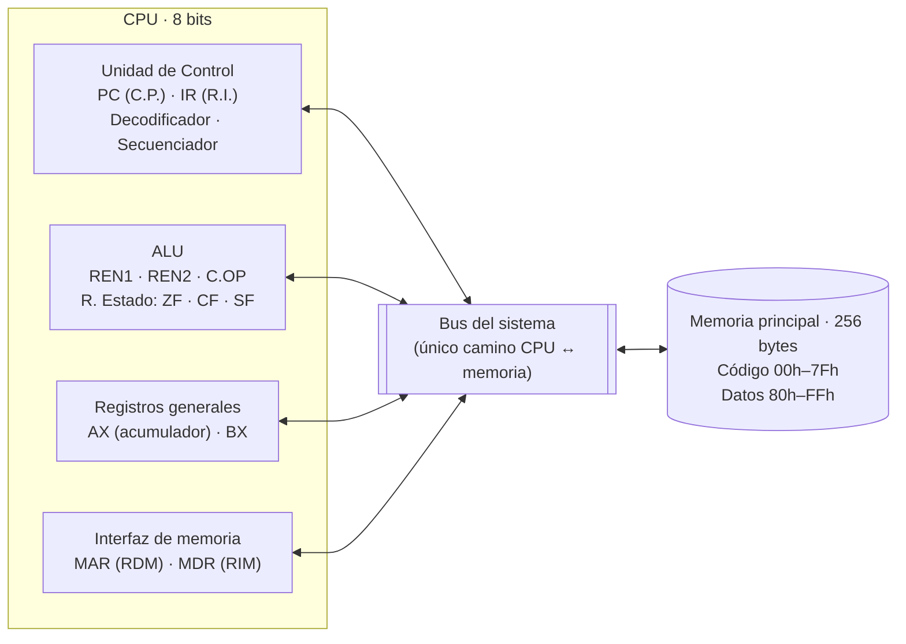
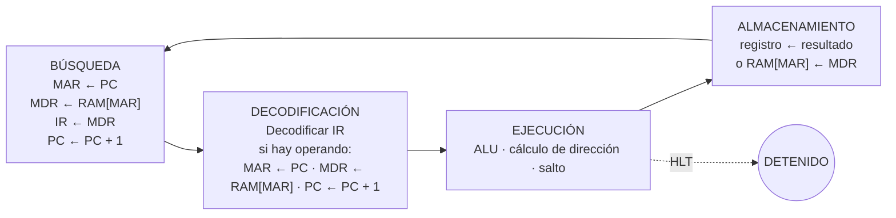

# Simulador de CPU · Arquitectura von Neumann de 8 bits

<p align="center">
  <br>
  <b>Equipo: Los Tigris</b>
</p>

Simulador interactivo del **ciclo de instrucción completo** y de la **memoria principal** de una computadora
von Neumann de 8 bits, construido en **Google Sheets + Google Apps Script**.

- **Materia:** Arquitectura de Computadoras (SIS-131) · Universidad Católica Boliviana "San Pablo", Santa Cruz
- **Docente:** Ing. Paulo César Loayza Carrasco
- **Equipo:** Los Tigris
- **Estudiantes:**
- Adrian Rada
- Diego Andrade
- Daniel Roca

> 🔗 **Simulador:** [Abrir la hoja de cálculo](PEGA_AQUI_EL_ENLACE_DE_TU_HOJA) (solo lectura; para usarlo: *Archivo → Hacer una copia*)

---

## Contenido

1. [Descripción](#1-descripción)
2. [Arquitectura von Neumann](#2-arquitectura-von-neumann)
3. [Mapa de memoria](#3-mapa-de-memoria)
4. [Registros y banderas](#4-registros-y-banderas)
5. [Ciclo de instrucción](#5-ciclo-de-instrucción)
6. [Conjunto de instrucciones (ISA)](#6-conjunto-de-instrucciones-isa)
7. [Ensamblador y compilador](#7-ensamblador-y-compilador)
8. [Manual de usuario](#8-manual-de-usuario)
9. [Programa demostrativo y traza](#9-programa-demostrativo-y-traza)
10. [Pruebas](#10-pruebas)
11. [Estructura del código](#11-estructura-del-código)
12. [Decisiones de diseño](#12-decisiones-de-diseño)
13. [Gestión del proyecto](#13-gestión-del-proyecto)
14. [Extensión para el Parcial 2](#14-extensión-para-el-parcial-2)

---

## 1. Descripción

El simulador ejecuta programas escritos en un **lenguaje de alto nivel** (que se compila) o directamente en
**ensamblador**, sobre una CPU de 8 bits con 256 bytes de RAM:

```
alto nivel ──compilador──▶ ensamblador ──ensamblador──▶ código máquina en RAM ──▶ ciclo de instrucción
```

Cada instrucción se descompone en **micro-operaciones** que se ejecutan una por una, recorriendo las cuatro fases
del ciclo: **búsqueda → decodificación → ejecución → almacenamiento**.

Todo es visible en la hoja: los registros, la memoria (16 × 16), la fase activa, la micro-operación actual,
el log cronológico y los componentes que participan en cada paso (resaltados en color).

| Requisito del enunciado | Dónde está |
|---|---|
| RAM de 256 bytes (00h–FFh) en hex, binario y decimal/mnemónico | Hoja **RAM** (matriz 16 × 16 + inspector) |
| Segmento de código y de datos | 00h–7Fh código · 80h–FFh datos |
| `Read(address)` / `Write(address, value)` | `Memoria.leer` / `Memoria.escribir` |
| PC, IR, MAR, MDR, AX, BX, ZF, CF, SF, ALU | Hoja **CPU** |
| Ciclo Fetch → Decode → Execute → Store | `UnidadControl.gs` + `MicroOperaciones.gs` |
| Paso a paso, continuo, STEP / RUN / PAUSE / RESET / LOAD | **Controles en la hoja CPU** (columna P) · también en el menú y en un panel lateral opcional |
| Resaltado visual y log de micro-operaciones | `Resaltado.gs`, hoja **Log** y panel de la hoja CPU |
| ISA mínima (MOV, LOAD, STORE, ADD, SUB, INC, DEC, CMP, JMP, JZ, JNZ, HLT) | Hoja **ISA** y [sección 6](#6-conjunto-de-instrucciones-isa) |
| Programa demostrativo con bucles y bifurcaciones | Multiplicación por sumas sucesivas ([sección 9](#9-programa-demostrativo-y-traza)) |
| Extra: compilador de alto nivel y traza de la línea en ejecución | `Compilador.gs`, `Traza.gs` ([sección 7](#7-ensamblador-y-compilador)) |

---

## 2. Arquitectura von Neumann



**Por qué es una arquitectura von Neumann:**

1. **Programa almacenado:** las instrucciones se ensamblan y se cargan en la RAM, igual que los datos.
2. **Una sola memoria** para código y datos. La separación 00h–7Fh / 80h–FFh es lógica, no física.
3. **Un solo camino a memoria:** la búsqueda de instrucciones y los `LOAD`/`STORE` usan el mismo MAR/MDR y el mismo bus.
   No se puede traer una instrucción y un dato a la vez: es el **cuello de botella de von Neumann**
   (un `LOAD` usa MAR/MDR dos veces para el opcode y el operando, y una tercera para el dato).
4. **Ejecución secuencial:** el PC avanza instrucción por instrucción; solo los saltos lo modifican.

| Componente | Módulo | Parcial |
|---|---|---|
| Unidad de Control | `UnidadControl.gs`, `MicroOperaciones.gs` | 1 ✔ |
| ALU | `ALU.gs` | 1 ✔ |
| Registros | `Registros.gs` | 1 ✔ |
| Memoria principal | `Memoria.gs`, `VistaRam.gs` | 1 ✔ |
| Bus del sistema | `Bus.gs` (abstracción simple) | 2 (multiplexado) |
| Entrada / Salida | — | 2 |

---

## 3. Mapa de memoria

| Rango | Segmento | Contenido |
|---|---|---|
| `00h – 7Fh` | Código | Instrucciones del programa (128 bytes) |
| `80h – FFh` | Datos | Variables declaradas con `DB` (128 bytes) |

- Palabra de **8 bits** por celda; la matriz de la hoja RAM es la fuente de verdad (editar una celda a mano cambia la memoria).
- El **inspector** (celda `U4` de la hoja RAM) muestra cualquier dirección en hex, binario, decimal con y sin signo, segmento y mnemónico.

---

## 4. Registros y banderas

| Registro | Nombre en clase | Función |
|---|---|---|
| PC | C.P. | Dirección de la siguiente instrucción |
| IR | R.I. | Opcode de la instrucción en curso |
| MAR | RDM | Dirección de memoria que se lee o escribe |
| MDR | RIM | Dato que llega de la RAM o va hacia ella |
| AX | Acumulador | Propósito general / resultados |
| BX | — | Propósito general |
| REN1, REN2 | Entradas de la ALU | Operandos A y B |
| C.OP | Código de operación | Operación que ejecuta la ALU |

| Bandera | Se activa cuando… |
|---|---|
| **ZF** (cero) | el resultado de 8 bits es `00h` |
| **CF** (acarreo) | una suma pasa de `FFh`, o una resta necesita préstamo (a < b) |
| **SF** (signo) | el bit 7 del resultado es 1 (negativo en complemento a 2) |

---

## 5. Ciclo de instrucción



Cada micro-operación es un paso del reloj. Todo movimiento de datos pasa por `Bus.transferir(origen, destino)`.

| Instrucción | Ejecución | Almacenamiento |
|---|---|---|
| `MOV r, inm` | — | `r ← MDR` |
| `LOAD r, [dir]` | `MAR ← MDR` · `MDR ← RAM[MAR]` | `r ← MDR` |
| `STORE [dir], r` | `MAR ← MDR` · `MDR ← r` | `RAM[MAR] ← MDR` |
| `ADD r, inm` | `REN1 ← r` · `REN2 ← MDR` · ALU | `r ← RESULTADO` |
| `CMP r, x` | `REN1 ← r` · `REN2 ← x` · ALU | (no guarda, solo banderas) |
| `JMP dir` | `PC ← MDR` | — |
| `JZ` / `JNZ dir` | `PC ← MDR` solo si ZF = 1 / 0 | — |
| `HLT` | detiene el reloj | — |

---

## 6. Conjunto de instrucciones (ISA)

- **35 instrucciones** de 1 o 2 bytes: `[opcode]` o `[opcode][operando]`.
- Opcodes agrupados por **nibble alto**: `0x` control · `1x` transferencia · `2x` aritmética · `3x` lógica · `4x` saltos.
- Modos de direccionamiento: implícito, registro, inmediato (`inm`), directo (`[dir]`) y absoluto (`dir`).

| Opcode | Mnemónico | Operandos | Bytes | Modo | Descripción |
|---|---|---|---|---|---|
| `00h` | HLT | — | 1 | implícito | Detiene el reloj del CPU |
| `10h` | MOV | AX, inm | 2 | inmediato | AX ← dato inmediato |
| `11h` | MOV | BX, inm | 2 | inmediato | BX ← dato inmediato |
| `12h` | MOV | AX, BX | 1 | registro | AX ← BX |
| `13h` | MOV | BX, AX | 1 | registro | BX ← AX |
| `14h` | LOAD | AX, [dir] | 2 | directo | AX ← RAM[dir] |
| `15h` | LOAD | BX, [dir] | 2 | directo | BX ← RAM[dir] |
| `16h` | STORE | [dir], AX | 2 | directo | RAM[dir] ← AX |
| `17h` | STORE | [dir], BX | 2 | directo | RAM[dir] ← BX |
| `20h` | ADD | AX, inm | 2 | inmediato | AX ← AX + inm |
| `21h` | ADD | AX, BX | 1 | registro | AX ← AX + BX |
| `22h` | ADD | BX, inm | 2 | inmediato | BX ← BX + inm |
| `23h` | ADD | BX, AX | 1 | registro | BX ← BX + AX |
| `24h` | SUB | AX, inm | 2 | inmediato | AX ← AX − inm |
| `25h` | SUB | AX, BX | 1 | registro | AX ← AX − BX |
| `26h` | SUB | BX, inm | 2 | inmediato | BX ← BX − inm |
| `27h` | SUB | BX, AX | 1 | registro | BX ← BX − AX |
| `28h` | INC | AX | 1 | registro | AX ← AX + 1 |
| `29h` | INC | BX | 1 | registro | BX ← BX + 1 |
| `2Ah` | DEC | AX | 1 | registro | AX ← AX − 1 |
| `2Bh` | DEC | BX | 1 | registro | BX ← BX − 1 |
| `2Ch` | CMP | AX, inm | 2 | inmediato | Banderas de AX − inm (no guarda) |
| `2Dh` | CMP | AX, BX | 1 | registro | Banderas de AX − BX (no guarda) |
| `2Eh` | CMP | BX, inm | 2 | inmediato | Banderas de BX − inm (no guarda) |
| `2Fh` | CMP | BX, AX | 1 | registro | Banderas de BX − AX (no guarda) |
| `30h` | AND | AX, inm | 2 | inmediato | AX ← AX AND inm |
| `31h` | AND | AX, BX | 1 | registro | AX ← AX AND BX |
| `32h` | OR | AX, inm | 2 | inmediato | AX ← AX OR inm |
| `33h` | OR | AX, BX | 1 | registro | AX ← AX OR BX |
| `34h` | XOR | AX, inm | 2 | inmediato | AX ← AX XOR inm |
| `35h` | XOR | AX, BX | 1 | registro | AX ← AX XOR BX |
| `36h` | NOT | AX | 1 | registro | AX ← NOT AX |
| `37h` | NOT | BX | 1 | registro | BX ← NOT BX |
| `40h` | JMP | dir | 2 | absoluto | PC ← dir (salto incondicional) |
| `41h` | JZ | dir | 2 | absoluto | Si ZF = 1: PC ← dir |
| `42h` | JNZ | dir | 2 | absoluto | Si ZF = 0: PC ← dir |

---

## 7. Ensamblador y compilador


**Sintaxis**

```asm
.data                   ; segmento de datos (desde 80h)
x      DB 5             ; variable de 1 byte
.code                   ; segmento de código (desde 00h)
bucle: LOAD AX, [x]     ; etiqueta + instrucción; [x] = dirección de memoria
       ADD AX, 0Fh      ; números: 15, 0x0F o 0Fh
       JNZ bucle        ; los saltos usan etiquetas
       HLT
```

- **1ª pasada:** calcula la dirección de cada instrucción y variable. Hace falta porque un salto puede usar una etiqueta que se define más abajo.
- **2ª pasada:** genera los bytes con la tabla ISA y reemplaza cada símbolo por su dirección.
- **Errores** con número de línea (mnemónico desconocido, operandos inválidos, símbolo no definido, duplicado, número fuera de 8 bits, segmento lleno). Se marcan en rojo en la hoja Código y el programa no se carga.

### Compilador de alto nivel

```text
// comentario
var a = 5                 // declaración: variable en el segmento de datos
var b = 3
var res = 0
mientras b != 0 {         // bucle
  res = res + a           // asignación con + y -
  b = b - 1
}
si res == 15 {            // condicional
  res = res + 0
}
```

**Gramática**

```text
programa   := sentencia*
sentencia  := 'var' ID '=' NUM | ID '=' expresion
            | 'mientras' condicion '{' sentencia* '}' | 'si' condicion '{' sentencia* '}'
expresion  := termino (('+' | '-') termino)*
condicion  := expresion ('==' | '!=') termino
termino    := NUM | ID
```

Solo hay `==` y `!=` porque la ISA tiene `JZ` y `JNZ`, que dependen únicamente de ZF.

**Etapas** (visibles en la hoja **Compilador**): tokens → **AST** (árbol indentado) → **ensamblador generado**
(con `; Ln:` indicando la línea de origen) → tabla de símbolos → código máquina.

| Construcción | Ensamblador generado (AX acumulador, BX temporal) |
|---|---|
| `x = a + 3` | `LOAD AX, [a]` · `ADD AX, 3` · `STORE [x], AX` |
| `x = a - b` | `LOAD AX, [a]` · `LOAD BX, [b]` · `SUB AX, BX` · `STORE [x], AX` |
| `mientras c != v { … }` | `_mN: …CMP` · `JZ _fN` · cuerpo · `JMP _mN` · `_fN:` |
| `si c == v { … }` | `…CMP` · `JNZ _sN` · cuerpo · `_sN:` |

**Traza:** mientras se ejecuta, la hoja Código resalta en ámbar la **línea de ensamblador** y la **línea de alto
nivel** de la instrucción en curso (sigue los saltos).

---

## 8. Manual de usuario

### Instalación
1. Crear una hoja de Google Sheets → **Extensiones → Apps Script**.
2. Copiar los archivos de `src/` al editor (o usar `clasp push`, ver [`docs/setup.md`](docs/setup.md)). El panel va en un archivo HTML llamado **`Panel`**.
3. Recargar la hoja → menú **Simulador CPU → Preparar libro** → aceptar permisos.

### Uso con los controles de la hoja CPU

En la hoja **CPU**, columna **P**, hay una columna de **controles**: cada uno es una casilla. Al marcarla se
ejecuta la acción y la casilla se desmarca sola (funciona como un botón).

| Control | Acción |
|---|---|
| ★ CARGAR DEMO | Escribe el demo de alto nivel en la hoja Código, lo compila y lo carga |
| ⚙ COMPILAR (col. B) | Compila el programa de alto nivel de la hoja Código |
| ⤓ ENSAMBLAR (col. E) | Ensambla el programa en ensamblador de la hoja Código |
| ▶\| PASO | Ejecuta una micro-operación |
| ⏭ INSTRUCCIÓN | Ejecuta la instrucción completa |
| ▶ EJECUTAR | Ejecución continua, instrucción por instrucción, con el **Retardo (ms)** de la celda R14 |
| ❚❚ PAUSA | Detiene EJECUTAR al terminar la instrucción actual (se puede continuar) |
| ↺ REINICIAR | Registros, banderas, log y colores en cero (la RAM se mantiene) |

Debajo de los controles, un cuadro muestra el resultado de la última acción o el error.

Los mismos comandos están en el menú **Simulador CPU** y en un panel lateral opcional
(**Simulador CPU → Abrir panel de control**).

### Qué mirar
- **Hoja CPU:** registros, fase activa, micro-operación, últimas 10 micro-operaciones.
  🟨 **Ámbar** = destino · 🟦 **Celeste** = origen.
- **Hoja RAM:** la celda que se lee o escribe se ilumina.
- **Hoja Log:** `[Paso NN] · #instrucción · fase · micro-operación · detalle`.
- **Hoja Compilador:** tokens, AST, ensamblador generado, tabla de símbolos y listado de código máquina.
- **Hoja Código:** la línea en ejecución (ensamblador y alto nivel) resaltada en ámbar.
- **Hoja Inicio:** portada con el logo y el equipo, guía de controles y leyenda de colores.
- **Hoja Buses:** buffers tri-estado, buses interno/externo, de direcciones y de control, y la micro-palabra de cada paso.

### Leyenda de colores
La misma leyenda está en la hoja **Inicio** y, compacta, en la hoja **CPU** debajo de los controles.

| Color | Significado |
|---|---|
| 🟨 Ámbar | Destino de la transferencia · componente que carga (`Ld_*`) · bit de la micro-palabra en 1 |
| 🟦 Celeste | Origen de la transferencia |
| 🟩 Verde | Buffer tri-estado que **conduce** · bus activo |
| ⬜ Gris | Buffer en **HIGH-Z** · bus o componente en reposo |
| 🟢 Verde claro | Hit de caché |
| 🟥 Rojo claro | Miss de caché · Page Fault |
| Azul claro / verde menta | Segmento de código / de datos en la RAM |
| Crema | Celda editable (entrada del usuario) |

### Menú Simulador CPU
| Opción | Acción |
|---|---|
| Cargar programa demo (5 × 3) | Escribe el demo en ensamblador en la hoja Código, lo ensambla y lo carga |
| Cargar demo de alto nivel (5 × 3) | Escribe el demo en alto nivel, lo compila y lo carga |
| Compilar alto nivel y cargar | Compila la columna B, escribe el ensamblador en la columna E y lo carga |
| Ensamblar y cargar programa | Ensambla la hoja Código y la carga en RAM |
| Paso / Ejecutar instrucción / Ejecutar hasta HLT | Ejecución por micro-operación, por instrucción o completa |
| Reiniciar CPU | Registros, banderas, log y ciclo desde cero |
| Pruebas → Ejecutar todas | Corre las 102 pruebas automáticas |

---

## 9. Programa demostrativo y traza

**Multiplicación por sumas sucesivas:** `res = a × b` sumando `a` tantas veces como indica `b`.
Usa un bucle (`JMP`), una bifurcación condicional (`CMP` + `JZ`), lectura/escritura en memoria y `HLT`.

```asm
; Multiplicación por sumas sucesivas: res = a × b
; Resultado esperado: RAM[82h] = 0Fh (15)
.data
a      DB 5           ; multiplicando          -> 80h
b      DB 3           ; multiplicador/contador -> 81h
res    DB 0           ; resultado              -> 82h
.code
       MOV AX, 0      ; res = 0
       STORE [res], AX
bucle: LOAD BX, [b]   ; ¿quedan vueltas?
       CMP BX, 0
       JZ fin         ; si b = 0 terminar
       DEC BX         ; b = b - 1
       STORE [b], BX
       LOAD AX, [res] ; res = res + a
       LOAD BX, [a]
       ADD AX, BX
       STORE [res], AX
       JMP bucle
fin:   HLT
```

### Versión en alto nivel

El mismo programa en el lenguaje de alto nivel (**★ DEMO ALTO NIVEL**) se compila a 18 líneas de ensamblador
(22 bytes) y da el mismo resultado:

```text
var a = 5
var b = 3
var res = 0
mientras b != 0 {
  res = res + a
  b = b - 1
}
```

```asm
_m1:  LOAD AX, [b]      ; L5: mientras b != 0 {
      CMP AX, 0
      JZ _f1
      LOAD AX, [res]    ; L6: res = res + a
      LOAD BX, [a]
      ADD AX, BX
      STORE [res], AX
      LOAD AX, [b]      ; L7: b = b - 1
      SUB AX, 1
      STORE [b], AX
      JMP _m1
_f1:
      HLT
```

### Código máquina generado (versión en ensamblador)

| Dirección | Bytes | Fuente |
|---|---|---|
| 00h | `10 00` | `MOV AX, 0` |
| 02h | `16 82` | `STORE [res], AX` |
| 04h | `15 81` | `bucle: LOAD BX, [b]` |
| 06h | `2E 00` | `CMP BX, 0` |
| 08h | `41 16` | `JZ fin` |
| 0Ah | `2B` | `DEC BX` |
| 0Bh | `17 81` | `STORE [b], BX` |
| 0Dh | `14 82` | `LOAD AX, [res]` |
| 0Fh | `15 80` | `LOAD BX, [a]` |
| 11h | `21` | `ADD AX, BX` |
| 12h | `16 82` | `STORE [res], AX` |
| 14h | `40 04` | `JMP bucle` |
| 16h | `00` | `fin: HLT` |
| 80h | `05` | `a DB 5` |
| 81h | `03` | `b DB 3` |
| 82h | `00` | `res DB 0` |

| Símbolo | Tipo | Dirección |
|---|---|---|
| `a` | variable | 80h |
| `b` | variable | 81h |
| `res` | variable | 82h |
| `bucle` | etiqueta | 04h |
| `fin` | etiqueta | 16h |

### Traza de registros (una fila por instrucción, valores al terminarla)

| # | PC inicial | Instrucción | Micro-ops | PC | AX | BX | ZF CF SF | RAM[81h] (b) | RAM[82h] (res) |
|---|---|---|---|---|---|---|---|---|---|
| 1 | 00h | `MOV AX, 00h` | 10 | 02h | 00h | 00h | 0 0 0 | 03h | 00h |
| 2 | 02h | `STORE [82h], AX` | 11 | 04h | 00h | 00h | 0 0 0 | 03h | 00h |
| 3 | 04h | `LOAD BX, [81h]` | 11 | 06h | 00h | 03h | 0 0 0 | 03h | 00h |
| 4 | 06h | `CMP BX, 00h` | 12 | 08h | 00h | 03h | 0 0 0 | 03h | 00h |
| 5 | 08h | `JZ 16h` | 9 | 0Ah | 00h | 03h | 0 0 0 | 03h | 00h |
| 6 | 0Ah | `DEC BX` | 8 | 0Bh | 00h | 02h | 0 0 0 | 03h | 00h |
| 7 | 0Bh | `STORE [81h], BX` | 11 | 0Dh | 00h | 02h | 0 0 0 | 02h | 00h |
| 8 | 0Dh | `LOAD AX, [82h]` | 11 | 0Fh | 00h | 02h | 0 0 0 | 02h | 00h |
| 9 | 0Fh | `LOAD BX, [80h]` | 11 | 11h | 00h | 05h | 0 0 0 | 02h | 00h |
| 10 | 11h | `ADD AX, BX` | 9 | 12h | 05h | 05h | 0 0 0 | 02h | 00h |
| 11 | 12h | `STORE [82h], AX` | 11 | 14h | 05h | 05h | 0 0 0 | 02h | 05h |
| 12 | 14h | `JMP 04h` | 9 | 04h | 05h | 05h | 0 0 0 | 02h | 05h |
| 13 | 04h | `LOAD BX, [81h]` | 11 | 06h | 05h | 02h | 0 0 0 | 02h | 05h |
| 14 | 06h | `CMP BX, 00h` | 12 | 08h | 05h | 02h | 0 0 0 | 02h | 05h |
| 15 | 08h | `JZ 16h` | 9 | 0Ah | 05h | 02h | 0 0 0 | 02h | 05h |
| 16 | 0Ah | `DEC BX` | 8 | 0Bh | 05h | 01h | 0 0 0 | 02h | 05h |
| 17 | 0Bh | `STORE [81h], BX` | 11 | 0Dh | 05h | 01h | 0 0 0 | 01h | 05h |
| 18 | 0Dh | `LOAD AX, [82h]` | 11 | 0Fh | 05h | 01h | 0 0 0 | 01h | 05h |
| 19 | 0Fh | `LOAD BX, [80h]` | 11 | 11h | 05h | 05h | 0 0 0 | 01h | 05h |
| 20 | 11h | `ADD AX, BX` | 9 | 12h | 0Ah | 05h | 0 0 0 | 01h | 05h |
| 21 | 12h | `STORE [82h], AX` | 11 | 14h | 0Ah | 05h | 0 0 0 | 01h | 0Ah |
| 22 | 14h | `JMP 04h` | 9 | 04h | 0Ah | 05h | 0 0 0 | 01h | 0Ah |
| 23 | 04h | `LOAD BX, [81h]` | 11 | 06h | 0Ah | 01h | 0 0 0 | 01h | 0Ah |
| 24 | 06h | `CMP BX, 00h` | 12 | 08h | 0Ah | 01h | 0 0 0 | 01h | 0Ah |
| 25 | 08h | `JZ 16h` | 9 | 0Ah | 0Ah | 01h | 0 0 0 | 01h | 0Ah |
| 26 | 0Ah | `DEC BX` | 8 | 0Bh | 0Ah | 00h | 1 0 0 | 01h | 0Ah |
| 27 | 0Bh | `STORE [81h], BX` | 11 | 0Dh | 0Ah | 00h | 1 0 0 | 00h | 0Ah |
| 28 | 0Dh | `LOAD AX, [82h]` | 11 | 0Fh | 0Ah | 00h | 1 0 0 | 00h | 0Ah |
| 29 | 0Fh | `LOAD BX, [80h]` | 11 | 11h | 0Ah | 05h | 1 0 0 | 00h | 0Ah |
| 30 | 11h | `ADD AX, BX` | 9 | 12h | 0Fh | 05h | 0 0 0 | 00h | 0Ah |
| 31 | 12h | `STORE [82h], AX` | 11 | 14h | 0Fh | 05h | 0 0 0 | 00h | 0Fh |
| 32 | 14h | `JMP 04h` | 9 | 04h | 0Fh | 05h | 0 0 0 | 00h | 0Fh |
| 33 | 04h | `LOAD BX, [81h]` | 11 | 06h | 0Fh | 00h | 0 0 0 | 00h | 0Fh |
| 34 | 06h | `CMP BX, 00h` | 12 | 08h | 0Fh | 00h | 1 0 0 | 00h | 0Fh |
| 35 | 08h | `JZ 16h` | 9 | 16h | 0Fh | 00h | 1 0 0 | 00h | 0Fh |
| 36 | 16h | `HLT` | 6 | 17h | 0Fh | 00h | 1 0 0 | 00h | 0Fh |

### Análisis

- **Resultado:** `res = 5 + 5 + 5 = 15 = 0Fh` en `RAM[82h]` ✔. El contador `b` termina en `00h`.
- **Instrucciones ejecutadas:** 2 de inicio + 10 por vuelta × 3 vueltas + 4 de salida (`LOAD`, `CMP`, `JZ`, `HLT`) = **36**.
- **Micro-operaciones:** **365** en total. Una instrucción de 2 bytes con acceso a memoria (`LOAD`/`STORE`) usa 11,
  de las cuales 3 son accesos a RAM por MAR/MDR: ahí se ve el cuello de botella de von Neumann.
- **Salida del bucle:** en la 4.ª comparación `BX = 0` → `ZF = 1` → `JZ 16h` carga `PC ← 16h` y se ejecuta `HLT`.
- Con valores que desbordan (130 × 2 = 260) el resultado queda en 8 bits: `260 mod 256 = 04h` (ver pruebas de casos borde).

---

## 10. Pruebas

Menú **Simulador CPU → Pruebas → Ejecutar todas** → **102/102 aprobadas**.

| Suite | Pruebas | Qué cubre |
|---|---|---|
| Memoria | 10 | lectura/escritura, conversión hex/bin, mapeo, segmentos, rangos |
| Registros | 5 | lectura/escritura, validación, banderas, reinicio |
| ALU | 18 | ADD, SUB, INC, DEC, AND, OR, XOR, NOT, CMP y sus banderas |
| ISA | 7 | opcodes únicos, instrucciones mínimas, búsqueda, formato |
| Bus | 6 | fase de búsqueda de la lámina, escritura en RAM, suscriptores |
| Ensamblador | 12 | léxico, dos pasadas, variables, errores, carga en RAM |
| Unidad de control | 11 | fases, operandos, LOAD/STORE, ALU, saltos, HLT, opcode inválido |
| Simulación | 12 | log, panel, resaltado, panel lateral, carga con errores, controles PASO/EJECUTAR/PAUSA |
| Casos borde | 11 | desbordamiento, negativos, ambas ramas de saltos, demo en ensamblador y en alto nivel |
| Compilador y traza | 10 | léxico, AST, generación de código, errores, demo compilado, traza |

---

## 11. Estructura del código

```
src/
├── appsscript.json        manifiesto (motor V8)
├── Configuracion.gs       hojas, mapa de memoria, colores
├── Memoria.gs             RAM: leer, escribir, volcar, cargar, limpiar
├── VistaRam.gs            matriz 16×16, segmentos, inspector
├── Registros.gs           PC, IR, MAR, MDR, AX, BX, REN1/2, banderas
├── ALU.gs                 operaciones aritméticas y lógicas + banderas
├── ISA.gs                 tabla de instrucciones (única fuente de verdad)
├── Bus.gs                 transferencias entre registros y RAM
├── EnsambladorLexico.gs   análisis léxico
├── Ensamblador.gs         ensamblador de dos pasadas
├── VistaCompilador.gs     etapas de compilación, símbolos, listado y errores en la hoja
├── Compilador.gs          compilador de alto nivel: léxico, parser (AST) y generación de código
├── Traza.gs               resalta la línea de ensamblador y de alto nivel en ejecución
├── MicroOperaciones.gs    micro-operaciones de cada instrucción (secuenciador)
├── UnidadControl.gs       ciclo de instrucción, una micro-operación por paso
├── LogMicroops.gs         hoja Log y panel de la hoja CPU
├── Resaltado.gs           colores de origen, destino y fase
├── Simulacion.gs          fachada para los controles, el menú y el panel lateral
├── Controles.gs           controles de la hoja CPU (casillas PASO, EJECUTAR, PAUSA…)
├── ProgramasDemo.gs       programa demostrativo
├── Libro.gs               construcción de las hojas y rangos con nombre
├── Principal.gs           menú y activadores
├── Panel.html             panel lateral (COMPILAR, ENSAMBLAR, DEMO, PASO, EJECUTAR, PAUSA, REINICIAR)
└── pruebas/               102 pruebas automáticas
```

Convención: nombres en español; se mantienen en inglés solo los nombres técnicos estándar
(PC, IR, MAR, MDR, AX, BX, ZF, CF, SF, mnemónicos y la API de Apps Script).

---

## 12. Decisiones de diseño

- **La hoja es la fuente de verdad:** registros y RAM viven en celdas, así se pueden modificar en vivo durante la ejecución.
- **Instrucciones de 1 o 2 bytes:** el operando se busca en la decodificación a través de MAR/MDR, como cualquier otro acceso a memoria.
- **PC + 1 antes de decodificar**, como indica el enunciado (en la lámina de clase el orden de los pasos 4 y 5 es inverso).
- **Banderas con una regla uniforme:** toda operación de la ALU recalcula ZF, CF y SF. A diferencia de x86, `INC`/`DEC` también actualizan CF; las operaciones lógicas dejan CF en 0.
- **Sin `ADD` con operando en memoria:** con solo AX y BX, el demo guarda el acumulado y el contador en RAM. Es más largo, pero muestra claramente el uso de MAR/MDR.
- **Estado de la Unidad de Control en `PropertiesService`:** Apps Script no conserva variables entre llamadas; la cola de micro-operaciones pendientes se guarda en las propiedades del documento.
- **Controles dentro de la hoja:** casillas atendidas por un activador instalable `onEdit` (un activador simple solo dura 30 s). EJECUTAR corre en su propia ejecución y revisa en cada instrucción una propiedad que PAUSA pone en 1; se detiene solo antes del límite de 6 minutos de Apps Script y se puede continuar.
- **Rendimiento:** los rangos de los registros se guardan en caché y el log se escribe en bloque.
- **El compilador genera ensamblador, no bytes:** reutiliza el ensamblador existente y deja visible el código intermedio, con comentarios que indican de qué línea de alto nivel viene cada instrucción.

---

## 13. Gestión del proyecto

- **Tablero Kanban** en GitHub Projects: Backlog → To Do → In Progress → In Review / Testing → Done.
- **Una rama por tarea** (`feat/assembler`, `feat/control-unit`, …) y **Pull Request** con `Closes #N`.
- **Commits convencionales** en español: `feat:`, `fix:`, `test:`, `docs:`, `refactor:`, `perf:`, `chore:`.
- Cada módulo tiene sus pruebas automáticas y cada PR indica cómo probarlo.

---

## 14. Extensión para el Parcial 2

El código está desacoplado para crecer sin reescribir el CPU:

- **Bus multiplexado:** todo movimiento de datos ya pasa por `Bus.transferir()`; se reemplaza su interior por líneas de dirección, datos y control.
- **Entrada/Salida:** nuevos dispositivos conectados al bus y nuevas instrucciones en `TABLA_ISA` + `MicroOperaciones.planificar`.
- **Interrupciones:** la Unidad de Control ya trabaja con una cola de micro-operaciones, donde se puede insertar la rutina de atención.
