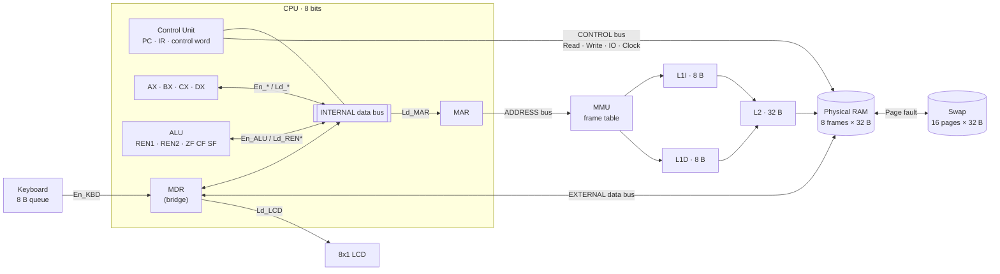
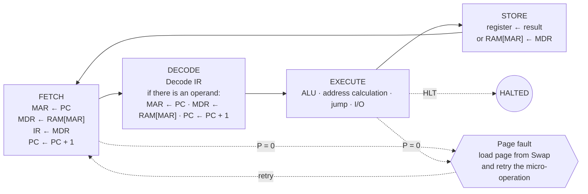
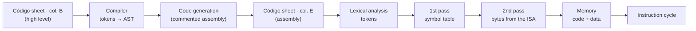

# CPU Simulator · 8-bit von Neumann Architecture

<p align="center">
  <br>
  <b>Team: Los Tigris</b>
</p>

<p align="center">🇪🇸 <a href="README.md">Español</a> · 🇬🇧 English</p>

Interactive simulator of an 8-bit von Neumann CPU built on **Google Sheets + Google Apps Script**:
full instruction cycle with a **control word**, **buses with tri-state buffers**, **virtual memory** with
page faults, **L1I / L1D / L2 cache**, and a memory-mapped **keyboard and LCD**.

- **Course:** Computer Architecture (SIS-131) · Universidad Católica Boliviana "San Pablo", Santa Cruz
- **Instructor:** Ing. Paulo César Loayza Carrasco
- **Team:** Los Tigris
- **Students:**
- Adrian Rada
- Diego Andrade
- Daniel Roca

> 🔗 **Simulator:** [Make a copy of the spreadsheet](https://docs.google.com/spreadsheets/d/13oXSHVaRQuWlUSj4PYN13QRjcHq-YjIuygGE0FeFRxw/copy) — the link ends in `/copy`: whoever opens it gets their own copy with the script included.
>
> 📦 **Repository:** [https://github.com/Dieg0-andrade/Arquitectura-Computadoras-Parcial-2](https://github.com/Dieg0-andrade/Arquitectura-Computadoras-Parcial-2)
>
> 🎞️ **Presentation:** [View slides on Canva](https://canva.link/z34w6gvmg8b2gc3)
---

## Contents

1. [Overview](#1-overview)
2. [Architecture](#2-architecture)
3. [Memory map](#3-memory-map)
4. [Registers and flags](#4-registers-and-flags)
5. [Instruction cycle](#5-instruction-cycle)
6. [Buses, tri-state buffers and control word](#6-buses-tri-state-buffers-and-control-word)
7. [Instruction set (ISA)](#7-instruction-set-isa)
8. [Virtual memory](#8-virtual-memory)
9. [L1I / L1D / L2 cache](#9-l1i--l1d--l2-cache)
10. [I/O peripherals](#10-io-peripherals)
11. [Assembler and compiler](#11-assembler-and-compiler)
12. [User manual](#12-user-manual)
13. [Programs](#13-programs)
14. [Tests](#14-tests)
15. [Code structure](#15-code-structure)
16. [Design decisions](#16-design-decisions)
17. [Project management and contributions](#17-project-management-and-contributions)

---

## 1. Overview

The simulator runs programs written in a **high-level language** (which is compiled) or directly in
**assembly**. Each instruction is broken down into **micro-operations** executed one at a time across the four
phases of the cycle: **fetch → decode → execute → store**. On every micro-step the control unit emits a 30-bit
**control word** that decides which tri-state buffers drive the bus.

```
high level ──compiler──▶ assembly ──assembler──▶ machine code in virtual memory ──▶ instruction cycle
                                                               │
                                 CPU ──▶ MMU ──▶ L1I / L1D ──▶ L2 ──▶ RAM (8 frames) ◀──▶ Swap (16 pages)
```

| Requirement | Where it is |
|---|---|
| Registers AX, BX, **CX, DX**, PC, IR, MAR, MDR, flags ZF, CF, SF | **CPU** sheet · `Registros.gs` |
| Control, address and data buses; internal and external | **Buses** sheet · `Bus.gs` ([section 6](#6-buses-tri-state-buffers-and-control-word)) |
| Tri-state buffers (CONDUCE / HIGH-Z) and a control word per step | `MicroPalabra.gs`, `VistaBuses.gs`, **Log** sheet (columns F and G) |
| 512 B virtual memory, 256 B RAM (8 frames × 32 B), page fault and swap | **TablaMarcos**, **Swap** and **RAM** sheets ([section 8](#8-virtual-memory)) |
| L1I 8 B, L1D 8 B, L2 32 B cache with hit/miss and counters | **Cache_IO** sheet ([section 9](#9-l1i--l1d--l2-cache)) |
| Memory-mapped keyboard (8 B queue) and 8x1 LCD, `IN` / `OUT` | **Cache_IO** sheet ([section 10](#10-io-peripherals)) |
| Fetch → Decode → Execute → Store cycle, step by step and continuous | `UnidadControl.gs`, `MicroOperaciones.gs` |
| STEP / RUN / PAUSE / RESET | **CPU** sheet controls (column P), menu and sidebar |
| Visual highlighting, log and color legend | `Resaltado.gs`, **Log** sheet, **Inicio** and **CPU** sheets |
| Team name and logo | **Inicio** sheet and this README |

---

## 2. Architecture



**It is still a von Neumann architecture:** code and data share a single (virtual) memory and a single MAR/MDR
path. An instruction and a datum cannot be fetched at the same time: this is the **von Neumann bottleneck**.
The cache splits L1I and L1D to ease it, but behind them there is a single L2 and a single RAM.

| Component | Module | Owner |
|---|---|---|
| Control unit and micro-operations | `UnidadControl.gs`, `MicroOperaciones.gs` | Adrian |
| Control word and tri-state buses | `MicroPalabra.gs`, `Bus.gs`, `VistaBuses.gs` | Adrian |
| Registers and ISA (CX, DX) | `Registros.gs`, `ISA.gs` | Adrian |
| Single memory-access contract | `AccesoMemoria.gs` | Adrian (contract) · Daniel (MMU) · Diego (cache) |
| MMU, frame table, page fault, replacement and swap | `MMU.gs`, `TablaMarcos.gs`, `ManejadorFallos.gs`, `Swap.gs` | Daniel |
| RAM in frames | `VistaRam.gs`, `Memoria.gs` | Daniel |
| L1I / L1D / L2 cache | `Cache.gs`, `VistaCache.gs`, `VistaCacheActividad.gs` | Diego |
| Keyboard, LCD, `IN` / `OUT` | `Perifericos.gs` | Diego |
| ALU, assembler, compiler (Parcial 1) | `ALU.gs`, `Ensamblador*.gs`, `Compilador.gs` | Parcial 1 base |

---

## 3. Memory map

**9-bit virtual space (000h–1FFh = 512 B, 16 pages of 32 B)** and **256 B of physical RAM (8 frames of 32 B)**.

| Virtual address | Pages | Segment | Notes |
|---|---|---|---|
| `000h – 0FFh` | 0 – 7 | Code | 8-bit `PC` = virtual code address |
| `100h – 1DFh` | 8 – 14 | Data | An 8-bit `[addr]` operand points to `100h + addr` |
| `1E0h – 1EFh` | 15 | I/O (free) | Page pinned to frame 7, not cached |
| `1F0h – 1F7h` | 15 | I/O | **Keyboard** queue (8 B) |
| `1F8h – 1FFh` | 15 | I/O | **LCD** buffer (8 B) |

- **Translation:** `VPN = addr >> 5`, `offset = addr & 31`, `physical = PFN × 32 + offset`.
- **Page 15** (I/O) is **pinned to frame 7**, is never evicted and **bypasses the cache**.
- With virtual memory turned off, the physical address equals the virtual one (Parcial 1 mode: code `00h–7Fh`, data `80h–FFh`).
- The **inspector** on the RAM sheet shows any address in hex, binary, decimal, segment and mnemonic.

---

## 4. Registers and flags

| Register | Name in class | Purpose |
|---|---|---|
| PC | C.P. | Address of the next instruction |
| IR | R.I. | Opcode of the current instruction |
| MAR | RDM | Address sent out on the address bus |
| MDR | RIM | Datum coming in or going out on the external data bus (bridge between both data buses) |
| AX | Accumulator | General purpose / results |
| BX | — | General purpose |
| **CX** | Counter | General purpose · loop counter (`DEC CX` + `JNZ`) |
| **DX** | Data | General purpose · data and I/O |
| REN1, REN2 | ALU inputs | Operands A and B |
| RESULTADO | ALU output | Result that goes back to the bus with `En_ALU` |

| Flag | Set when… |
|---|---|
| **ZF** (zero) | the 8-bit result is `00h` |
| **CF** (carry) | an addition goes past `FFh`, or a subtraction needs a borrow (a < b) |
| **SF** (sign) | bit 7 of the result is 1 (negative in two's complement) |

---

## 5. Instruction cycle



Each micro-operation is one clock step and has its own **control word** ([section 6](#6-buses-tri-state-buffers-and-control-word)).
If the page is not in RAM, the fault handler brings it in from the Swap and **retries the failed micro-operation without advancing the PC**.

| Instruction | Execute | Store |
|---|---|---|
| `MOV r, imm` | — | `r ← MDR` |
| `MOV r1, r2` | — | `r1 ← r2` |
| `LOAD r, [addr]` | `MAR ← MDR` · `MDR ← RAM[MAR]` | `r ← MDR` |
| `STORE [addr], r` | `MAR ← MDR` · `MDR ← r` | `RAM[MAR] ← MDR` |
| `ADD r, x` | `REN1 ← r` · `REN2 ← x` · ALU | `r ← RESULT` |
| `CMP r, x` | `REN1 ← r` · `REN2 ← x` · ALU | (not stored, flags only) |
| `IN r, [KBD]` | `MAR ← MDR` · `MDR ← KBD` | `r ← MDR` |
| `OUT [LCD], r` | `MAR ← MDR` · `MDR ← r` | `LCD ← MDR` |
| `JMP addr` | `PC ← MDR` | — |
| `JZ` / `JNZ addr` | `PC ← MDR` only if ZF = 1 / 0 | — |
| `HLT` | stops the clock | — |

---

## 6. Buses, tri-state buffers and control word

Full detail (in Spanish): [`docs/buses.md`](docs/buses.md) and [`docs/microword.md`](docs/microword.md).

### Buses

| Bus | Connects | Driven by |
|---|---|---|
| **Internal data** | PC, IR, MAR, MDR, AX, BX, CX, DX, REN1, REN2, ALU | the component with `En_*` = 1 |
| **External data** | MDR, RAM, keyboard, LCD | RAM (`En_RAM`), keyboard (`En_KBD`) or MDR (`En_MDR` + `Mem_W`) |
| **Address** | MAR → MMU → cache / RAM or I/O | MAR, when `Mem_R` or `Mem_W` is set |
| **Control** | Control unit → memory and I/O | lines `Read`, `Write`, `IO`, `Clock` |

The **MDR is the bridge**: it is the only register connected to both data buses. RAM, keyboard and LCD talk to the CPU only through the MDR.

### Tri-state rules

- `En_X = 1` → X's buffer **drives** the bus (CONDUCE, green on the Buses sheet). `En_X = 0` → **HIGH-Z** (gray).
- `Ld_X = 1` → X **latches** the value on the bus (amber). Several receivers can load at once.
- **At most one `En_*` per micro-step** (decision D-8). Two drivers = error, and the CPU stops with `ERROR` **without executing the step**.
- Driver and receivers must be on the **same data bus**; between the internal and external bus data goes through the MDR.
- `Mem_R` and `Mem_W` are never set together; a register never drives and loads in the same step.

### Control word (30 bits)

26 one-bit signals + the 4-bit `ALU_op` field, in this order (bit 29 on the left):

| Bits | Signals |
|---|---|
| 29–27 | `En_PC` · `Ld_PC` · `Inc_PC` |
| 26–21 | `Ld_MAR` · `Mem_R` · `Mem_W` · `Ld_MDR` · `En_MDR` · `En_RAM` |
| 20–19 | `Ld_IR` · `En_IR` |
| 18–15 | `En_ALU` · `Ld_REN1` · `Ld_REN2` · `Ld_FLAGS` |
| 14–7 | `Ld_AX` · `En_AX` · `Ld_BX` · `En_BX` · `Ld_CX` · `En_CX` · `Ld_DX` · `En_DX` |
| 6–4 | `En_KBD` · `Ld_LCD` · `IO` |
| 3–0 | `ALU_op`: `0000` none · `0001` ADD · `0010` SUB · `0011` INC · `0100` DEC · `0101` CMP · `0110` AND · `0111` OR · `1000` XOR · `1001` NOT |

**Example: fetch phase**

| Micro-operation | Signals set to 1 | Active bus | Drivers |
|---|---|---|---|
| `MAR ← PC` | `En_PC` `Ld_MAR` | internal: PC → MAR | PC |
| `MDR ← RAM[MAR]` | `Mem_R` `En_RAM` `Ld_MDR` | external: RAM → MDR | RAM, MAR (address) |
| `IR ← MDR` | `En_MDR` `Ld_IR` | internal: MDR → IR | MDR |
| `PC ← PC + 1` | `Inc_PC` | none (everything HIGH-Z) | — |

`MAR ← PC` in bits: `1001 0000 0000 0000 0000 0000 0000 00`. The **Log** sheet records the control word and its bits
on every step, and the **Buses** sheet draws it with the buffers in green or gray.

---

## 7. Instruction set (ISA)

- **100 instructions** of 1 or 2 bytes: 36 from Parcial 1 (AX, BX), 56 with **CX and DX**, and 8 for **I/O**.
- Opcodes: `0x` control · `1x` transfer · `2x` arithmetic · `3x` logic · `4x` jumps · `5x` **I/O** ·
  `6x` CX/DX INC/DEC and immediate operations · `7x`–`Ax` register-to-register MOV/ADD/SUB/CMP (`base + 4·dest + src`, with AX = 0, BX = 1, CX = 2, DX = 3).
- Addressing modes: implied, register, immediate (`imm`), direct (`[addr]`), absolute (`addr`) and I/O.
- The same table is on the **ISA** sheet (generated from `ISA.gs`, the single source of truth). CX/DX detail: [`docs/isa-cx-dx.md`](docs/isa-cx-dx.md).

<details>
<summary><b>Full table (100 instructions)</b></summary>

| Opcode | Mnemonic | Operands | Bytes | Mode | Description |
|---|---|---|---|---|---|
| `00h` | HLT | — | 1 | implied | Stops the CPU clock |
| `10h` | MOV | AX, imm | 2 | immediate | AX ← immediate value |
| `11h` | MOV | BX, imm | 2 | immediate | BX ← immediate value |
| `12h` | MOV | AX, BX | 1 | register | AX ← BX |
| `13h` | MOV | BX, AX | 1 | register | BX ← AX |
| `14h` | LOAD | AX, [addr] | 2 | direct | AX ← RAM[addr] |
| `15h` | LOAD | BX, [addr] | 2 | direct | BX ← RAM[addr] |
| `16h` | STORE | [addr], AX | 2 | direct | RAM[addr] ← AX |
| `17h` | STORE | [addr], BX | 2 | direct | RAM[addr] ← BX |
| `18h` | MOV | CX, imm | 2 | immediate | CX ← immediate value |
| `19h` | MOV | DX, imm | 2 | immediate | DX ← immediate value |
| `1Ah` | LOAD | CX, [addr] | 2 | direct | CX ← RAM[addr] |
| `1Bh` | LOAD | DX, [addr] | 2 | direct | DX ← RAM[addr] |
| `1Ch` | STORE | [addr], CX | 2 | direct | RAM[addr] ← CX |
| `1Dh` | STORE | [addr], DX | 2 | direct | RAM[addr] ← DX |
| `20h` | ADD | AX, imm | 2 | immediate | AX ← AX + imm |
| `21h` | ADD | AX, BX | 1 | register | AX ← AX + BX |
| `22h` | ADD | BX, imm | 2 | immediate | BX ← BX + imm |
| `23h` | ADD | BX, AX | 1 | register | BX ← BX + AX |
| `24h` | SUB | AX, imm | 2 | immediate | AX ← AX − imm |
| `25h` | SUB | AX, BX | 1 | register | AX ← AX − BX |
| `26h` | SUB | BX, imm | 2 | immediate | BX ← BX − imm |
| `27h` | SUB | BX, AX | 1 | register | BX ← BX − AX |
| `28h` | INC | AX | 1 | register | AX ← AX + 1 |
| `29h` | INC | BX | 1 | register | BX ← BX + 1 |
| `2Ah` | DEC | AX | 1 | register | AX ← AX − 1 |
| `2Bh` | DEC | BX | 1 | register | BX ← BX − 1 |
| `2Ch` | CMP | AX, imm | 2 | immediate | Flags of AX − imm (result not stored) |
| `2Dh` | CMP | AX, BX | 1 | register | Flags of AX − BX (result not stored) |
| `2Eh` | CMP | BX, imm | 2 | immediate | Flags of BX − imm (result not stored) |
| `2Fh` | CMP | BX, AX | 1 | register | Flags of BX − AX (result not stored) |
| `30h` | AND | AX, imm | 2 | immediate | AX ← AX AND imm |
| `31h` | AND | AX, BX | 1 | register | AX ← AX AND BX |
| `32h` | OR | AX, imm | 2 | immediate | AX ← AX OR imm |
| `33h` | OR | AX, BX | 1 | register | AX ← AX OR BX |
| `34h` | XOR | AX, imm | 2 | immediate | AX ← AX XOR imm |
| `35h` | XOR | AX, BX | 1 | register | AX ← AX XOR BX |
| `36h` | NOT | AX | 1 | register | AX ← NOT AX |
| `37h` | NOT | BX | 1 | register | BX ← NOT BX |
| `40h` | JMP | addr | 2 | absolute | PC ← addr (unconditional jump) |
| `41h` | JZ | addr | 2 | absolute | If ZF = 1: PC ← addr |
| `42h` | JNZ | addr | 2 | absolute | If ZF = 0: PC ← addr |
| `50h` | IN | AX, [KBD] | 2 | I/O | Read one byte from the keyboard into AX |
| `51h` | IN | BX, [KBD] | 2 | I/O | Read one byte from the keyboard into BX |
| `52h` | IN | CX, [KBD] | 2 | I/O | Read one byte from the keyboard into CX |
| `53h` | IN | DX, [KBD] | 2 | I/O | Read one byte from the keyboard into DX |
| `54h` | OUT | [LCD], AX | 2 | I/O | Send AX to the LCD |
| `55h` | OUT | [LCD], BX | 2 | I/O | Send BX to the LCD |
| `56h` | OUT | [LCD], CX | 2 | I/O | Send CX to the LCD |
| `57h` | OUT | [LCD], DX | 2 | I/O | Send DX to the LCD |
| `60h` | INC | CX | 1 | register | CX ← CX + 1 |
| `61h` | INC | DX | 1 | register | DX ← DX + 1 |
| `62h` | DEC | CX | 1 | register | CX ← CX − 1 |
| `63h` | DEC | DX | 1 | register | DX ← DX − 1 |
| `64h` | ADD | CX, imm | 2 | immediate | CX ← CX + imm |
| `65h` | ADD | DX, imm | 2 | immediate | DX ← DX + imm |
| `66h` | SUB | CX, imm | 2 | immediate | CX ← CX − imm |
| `67h` | SUB | DX, imm | 2 | immediate | DX ← DX − imm |
| `68h` | CMP | CX, imm | 2 | immediate | Flags of CX − imm (result not stored) |
| `69h` | CMP | DX, imm | 2 | immediate | Flags of DX − imm (result not stored) |
| `72h` | MOV | AX, CX | 1 | register | AX ← CX |
| `73h` | MOV | AX, DX | 1 | register | AX ← DX |
| `76h` | MOV | BX, CX | 1 | register | BX ← CX |
| `77h` | MOV | BX, DX | 1 | register | BX ← DX |
| `78h` | MOV | CX, AX | 1 | register | CX ← AX |
| `79h` | MOV | CX, BX | 1 | register | CX ← BX |
| `7Bh` | MOV | CX, DX | 1 | register | CX ← DX |
| `7Ch` | MOV | DX, AX | 1 | register | DX ← AX |
| `7Dh` | MOV | DX, BX | 1 | register | DX ← BX |
| `7Eh` | MOV | DX, CX | 1 | register | DX ← CX |
| `82h` | ADD | AX, CX | 1 | register | AX ← AX + CX |
| `83h` | ADD | AX, DX | 1 | register | AX ← AX + DX |
| `86h` | ADD | BX, CX | 1 | register | BX ← BX + CX |
| `87h` | ADD | BX, DX | 1 | register | BX ← BX + DX |
| `88h` | ADD | CX, AX | 1 | register | CX ← CX + AX |
| `89h` | ADD | CX, BX | 1 | register | CX ← CX + BX |
| `8Bh` | ADD | CX, DX | 1 | register | CX ← CX + DX |
| `8Ch` | ADD | DX, AX | 1 | register | DX ← DX + AX |
| `8Dh` | ADD | DX, BX | 1 | register | DX ← DX + BX |
| `8Eh` | ADD | DX, CX | 1 | register | DX ← DX + CX |
| `92h` | SUB | AX, CX | 1 | register | AX ← AX − CX |
| `93h` | SUB | AX, DX | 1 | register | AX ← AX − DX |
| `96h` | SUB | BX, CX | 1 | register | BX ← BX − CX |
| `97h` | SUB | BX, DX | 1 | register | BX ← BX − DX |
| `98h` | SUB | CX, AX | 1 | register | CX ← CX − AX |
| `99h` | SUB | CX, BX | 1 | register | CX ← CX − BX |
| `9Bh` | SUB | CX, DX | 1 | register | CX ← CX − DX |
| `9Ch` | SUB | DX, AX | 1 | register | DX ← DX − AX |
| `9Dh` | SUB | DX, BX | 1 | register | DX ← DX − BX |
| `9Eh` | SUB | DX, CX | 1 | register | DX ← DX − CX |
| `A2h` | CMP | AX, CX | 1 | register | Flags of AX − CX (result not stored) |
| `A3h` | CMP | AX, DX | 1 | register | Flags of AX − DX (result not stored) |
| `A6h` | CMP | BX, CX | 1 | register | Flags of BX − CX (result not stored) |
| `A7h` | CMP | BX, DX | 1 | register | Flags of BX − DX (result not stored) |
| `A8h` | CMP | CX, AX | 1 | register | Flags of CX − AX (result not stored) |
| `A9h` | CMP | CX, BX | 1 | register | Flags of CX − BX (result not stored) |
| `ABh` | CMP | CX, DX | 1 | register | Flags of CX − DX (result not stored) |
| `ACh` | CMP | DX, AX | 1 | register | Flags of DX − AX (result not stored) |
| `ADh` | CMP | DX, BX | 1 | register | Flags of DX − BX (result not stored) |
| `AEh` | CMP | DX, CX | 1 | register | Flags of DX − CX (result not stored) |
</details>

---

## 8. Virtual memory

> **Technical documentation:** [Virtual memory (EN)](docs/virtual-memory.md) · [Memoria virtual (ES)](docs/memoria-virtual.md) · [Test results](docs/testing.md).

- **512 B of virtual memory** (16 pages of 32 B) on top of **256 B of RAM** (8 frames of 32 B). The **Swap** sheet holds the 16 pages (it is the "disk").
- **Frame table** (**TablaMarcos** sheet): one row per page with `VPN`, `P` (present), `PFN`, `Dirty` and `Ref`.
- **Translation** (`MMU.traducir`): `VPN = addr >> 5`, `offset = addr & 31`, `physical = PFN × 32 + offset`. The panel shows the last translation and the Log keeps the 10 most recent ones.
- **Page fault:** if `P = 0`, the entry is highlighted in red, a free frame (or a victim) is chosen, 32 B are copied from the Swap, `P` is set to 1 and the **micro-operation is retried** (decision D-7).
- **FIFO or LRU replacement** (selectable on the TablaMarcos sheet). If the victim has `Dirty = 1`, it is written back to the Swap before being replaced, and its cache lines are invalidated. Page 15 (I/O) is never evicted.
- **Counters** for faults and evictions.

---

## 9. L1I / L1D / L2 cache

> **Technical documentation** (Diego Andrade): [Cache, I/O and program catalog](docs/cache-io.md).

- **Access order:** CPU → MMU → L1I (instructions) or L1D (data) → L2 → RAM. The cache works with **physical addresses**.
- **L1I and L1D:** one 8 B line each. **L2:** 32 B (4 lines of 8 B), shared.
- **Write-through** with **write-allocate**: RAM and every cached copy of the datum in L1I, L1D and L2 are updated.
- An L1 hit does not count in L2. **Hit rate** = hits / (hits + misses), 0 before the first access.
- **Hit and miss counters** per level and **hit rate**. Each access is painted green (hit) or red (miss) on the **Cache_IO** sheet and noted in the Log.
- Accesses to page 15 (I/O) **bypass the cache**. Loading a program or evicting a page invalidates the affected lines.

---

## 10. I/O peripherals

> **Technical documentation** (Diego Andrade): [Cache, I/O and program catalog](docs/cache-io.md).

| Device | Virtual address | Physical address | Instruction | Control word |
|---|---|---|---|---|
| **Keyboard** (8 B circular FIFO queue) | `1F0h – 1F7h` | `F0h – F7h` | `IN r, [KBD]` | `IO` `Mem_R` `En_KBD` `Ld_MDR` |
| **8x1 LCD** (8 B buffer) | `1F8h – 1FFh` | `F8h – FFh` | `OUT [LCD], r` | `IO` `Mem_W` `En_MDR` `Ld_LCD` |

- On the **Cache_IO** sheet, type a character into cell **C33** and it is queued (shown in `B31:I31`, in output order); `IN` takes the oldest byte. A full queue rejects new input; reading an empty queue returns 0.
- The LCD is shown in `Cache_IO!K31:R31`; ASCII codes 32–126 are displayed as characters.
- `OUT` writes one byte to the LCD buffer and the 8-character display refreshes.
- Both use the external bus with `IO = 1` and always go through the MDR.

```asm
.code
IN  AX, [KBD]     ; AX ← character from the keyboard queue
OUT [LCD], AX     ; echo it on the LCD
HLT
```

---

## 11. Assembler and compiler



**Syntax**

```asm
.data                   ; data segment
x      DB 5             ; 1-byte variable
.code                   ; code segment (from 00h)
loop:  LOAD AX, [x]     ; label + instruction; [x] = memory address
       ADD AX, 0Fh      ; numbers: 15, 0x0F or 0Fh
       JNZ loop         ; jumps use labels
       HLT
```

- **1st pass:** computes the address of every instruction and variable. It is needed because a jump can use a label defined further down.
- **2nd pass:** generates the bytes from the ISA table and replaces every symbol with its address.
- **Errors** include the line number (unknown mnemonic, invalid operands, undefined or duplicate symbol, number out of 8 bits, full segment). They are marked in red on the Código sheet and the program is not loaded.

### High-level compiler

The language keywords are in Spanish (`var`, `mientras` = while, `si` = if):

```text
// comment
var a = 5                 // declaration: variable in the data segment
var b = 3
var res = 0
mientras b != 0 {         // loop (while)
  res = res + a           // assignment with + and -
  b = b - 1
}
si res == 15 {            // conditional (if)
  res = res + 0
}
```

**Grammar**

```text
program    := statement*
statement  := 'var' ID '=' NUM | ID '=' expression
            | 'mientras' condition '{' statement* '}' | 'si' condition '{' statement* '}'
expression := term (('+' | '-') term)*
condition  := expression ('==' | '!=') term
term       := NUM | ID
```

Only `==` and `!=` exist because the ISA has `JZ` and `JNZ`, which depend only on ZF.

**Stages** (visible on the **Compilador** sheet): tokens → **AST** (indented tree) → **generated assembly**
(with `; Ln:` showing the source line) → symbol table → machine code.

| Construct | Generated assembly (AX accumulator, BX temporary) |
|---|---|
| `x = a + 3` | `LOAD AX, [a]` · `ADD AX, 3` · `STORE [x], AX` |
| `x = a - b` | `LOAD AX, [a]` · `LOAD BX, [b]` · `SUB AX, BX` · `STORE [x], AX` |
| `mientras c != v { … }` | `_mN: …CMP` · `JZ _fN` · body · `JMP _mN` · `_fN:` |
| `si c == v { … }` | `…CMP` · `JNZ _sN` · body · `_sN:` |

**Trace:** while running, the Código sheet highlights in amber the **assembly line** and the **high-level line**
of the current instruction (it follows jumps).

---

## 12. User manual

### Installation
1. From the repo root: `node herramientas/construir.js` → generates `dist/SimuladorCompleto.gs` and `dist/Panel.html`.
2. Create a Google Sheets spreadsheet (region **United States** in *File → Settings*) → **Extensions → Apps Script**.
3. Paste `dist/SimuladorCompleto.gs`; for the sidebar, create an HTML file named **`Panel`** and paste `dist/Panel.html`.
4. Reload the spreadsheet → menu **Simulador CPU → Preparar libro** → accept the permissions.

Or, easier: open the **spreadsheet link** above (it ends in `/copy`) and make a copy, which already includes the script.

### Using the CPU sheet controls

On the **CPU** sheet, column **P**, each control is a checkbox: tick it to run the action and it unticks itself.

| Control | Action |
|---|---|
| ★ CARGAR DEMO | Writes the high-level demo on the Código sheet, compiles and loads it |
| ⚙ COMPILAR (col. B) | Compiles the high-level program on the Código sheet |
| ⤓ ENSAMBLAR (col. E) | Assembles the assembly program on the Código sheet |
| ▶\| PASO (step) | Runs one micro-operation |
| ⏭ INSTRUCCIÓN | Runs the whole current instruction |
| ▶ EJECUTAR (run) | Continuous run, instruction by instruction, with a configurable **delay (ms)** |
| ❚❚ PAUSA (pause) | Stops RUN after the current instruction (it can be resumed) |
| ↺ REINICIAR (reset) | Registers, flags, log, colors and buses back to zero (RAM is kept) |

The same commands are in the **Simulador CPU** menu and in the sidebar (**Simulador CPU → Abrir panel de control**).

### Sheets

| Sheet | What it shows |
|---|---|
| **Inicio** | Cover: logo, team, controls guide and color legend |
| **CPU** | Registers, phase, micro-operation, last 10 micro-operations and controls |
| **Buses** | Tri-state buffers, internal / external / address / control buses and the 30 control-word bits |
| **RAM** | Physical memory in 8 frames of 32 B + inspector |
| **Código** | High-level (col. B) and assembly (col. E) program, with the running line highlighted |
| **Compilador** | Tokens, AST, generated assembly, symbols and machine code |
| **Log** | `[Paso NN]` · instruction · phase · micro-operation · detail · **control word** · **bits** |
| **ISA** | The 100 instructions |
| **Cache_IO** | L1I, L1D, L2, counters and hit rate, keyboard and LCD |
| **Swap** | The 16 virtual pages of 32 B |
| **TablaMarcos** | Page table (P, PFN, Dirty, Ref), last translation, FIFO / LRU and fault counters |
| **Programas** | Catalog of the 3 programs: selection, loading and result check |

### Color legend
The same legend is on the **Inicio** sheet and, in compact form, on the **CPU** sheet below the controls.

| Color | Meaning |
|---|---|
| 🟨 Amber | Transfer destination · component that loads (`Ld_*`) · control-word bit set to 1 |
| 🟦 Light blue | Transfer source |
| 🟩 Green | Tri-state buffer **driving** the bus · active bus |
| ⬜ Gray | Buffer in **HIGH-Z** · idle bus or component |
| 🟢 Light green | Cache hit |
| 🟥 Light red | Cache miss · page fault |
| Pale blue / mint green | Code / data segment in RAM |
| Cream | Editable cell (user input) |

### Simulador CPU menu
| Option | Action |
|---|---|
| Preparar libro | Builds (or rebuilds) every sheet |
| Cargar programa demo / demo de alto nivel | Writes the demo on the Código sheet and loads it |
| Compilar alto nivel y cargar · Ensamblar y cargar programa | Loads whatever is written on the Código sheet |
| Paso / Ejecutar instrucción / Ejecutar hasta HLT | Runs by micro-operation, by instruction or to completion |
| Reiniciar CPU · Limpiar RAM | Reset the CPU or the RAM to zero |
| Pruebas → Ejecutar todas | Runs every automated test ([section 14](#14-tests)) |

---

## 13. Programs

### Program catalog

**Programas** sheet (menu **Simulador CPU → Abrir catalogo de programas**): pick the program in `B3`, load it with **Cargar programa del catalogo**, run it with the controls and check it with **Verificar resultado del catalogo**. Details in [`docs/cache-io.md`](docs/cache-io.md).

| # | Program | What it does | Expected result |
|---|---|---|---|
| 1 | **Bucle aritmetico AX-DX** (arithmetic loop) | Adds 4 three times: AX accumulates, BX holds 4, CX counts the iterations (`DEC CX` + `JNZ`) and DX keeps the result | HLT · AX = 12, BX = 4, CX = 0, DX = 12 |
| 2 | **Eco teclado-LCD** (keyboard echo) | `IN AX, [KBD]` reads the letter typed in `Cache_IO!C33` and `OUT [LCD], AX` shows it in the first LCD position | HLT · AX = ASCII code · the LCD shows the letter |
| 3 | **Accesos dispersos** (scattered accesses) | Adds data spread over 7 pages; the page holding `p6` starts absent | HLT · AX = 28 · page faults > 0 · L1D and L2 misses > 0 |

### Assembly editor

Menu **Simulador CPU → Abrir editor de ensamblador**: write the program on the **Código** sheet, **Validar sintaxis del editor** marks the line with an error, and **Cargar editor en memoria virtual** assembles it and loads it into the virtual pages.

### Parcial 1 demo program and trace

**Multiplication by repeated addition:** `res = a × b` by adding `a` as many times as `b` says.
It uses a loop (`JMP`), a conditional branch (`CMP` + `JZ`), memory reads/writes and `HLT`.

```asm
; Multiplication by repeated addition: res = a × b
; Expected result: RAM[82h] = 0Fh (15)
.data
a      DB 5           ; multiplicand          -> 80h
b      DB 3           ; multiplier / counter  -> 81h
res    DB 0           ; result                -> 82h
.code
       MOV AX, 0      ; res = 0
       STORE [res], AX
bucle: LOAD BX, [b]   ; any iterations left?
       CMP BX, 0
       JZ fin         ; if b = 0, finish
       DEC BX         ; b = b - 1
       STORE [b], BX
       LOAD AX, [res] ; res = res + a
       LOAD BX, [a]
       ADD AX, BX
       STORE [res], AX
       JMP bucle
fin:   HLT
```

The same program in the high-level language (**★ CARGAR DEMO**) compiles to 18 lines of assembly (22 bytes) and gives the same result:

```text
var a = 5
var b = 3
var res = 0
mientras b != 0 {
  res = res + a
  b = b - 1
}
```

```asm
_m1:  LOAD AX, [b]      ; L5: mientras b != 0 {
      CMP AX, 0
      JZ _f1
      LOAD AX, [res]    ; L6: res = res + a
      LOAD BX, [a]
      ADD AX, BX
      STORE [res], AX
      LOAD AX, [b]      ; L7: b = b - 1
      SUB AX, 1
      STORE [b], AX
      JMP _m1
_f1:
      HLT
```

### Generated machine code (assembly version)

| Address | Bytes | Source |
|---|---|---|
| 00h | `10 00` | `MOV AX, 0` |
| 02h | `16 82` | `STORE [res], AX` |
| 04h | `15 81` | `bucle: LOAD BX, [b]` |
| 06h | `2E 00` | `CMP BX, 0` |
| 08h | `41 16` | `JZ fin` |
| 0Ah | `2B` | `DEC BX` |
| 0Bh | `17 81` | `STORE [b], BX` |
| 0Dh | `14 82` | `LOAD AX, [res]` |
| 0Fh | `15 80` | `LOAD BX, [a]` |
| 11h | `21` | `ADD AX, BX` |
| 12h | `16 82` | `STORE [res], AX` |
| 14h | `40 04` | `JMP bucle` |
| 16h | `00` | `fin: HLT` |
| 80h | `05` | `a DB 5` |
| 81h | `03` | `b DB 3` |
| 82h | `00` | `res DB 0` |

| Symbol | Type | Address |
|---|---|---|
| `a` | variable | 80h |
| `b` | variable | 81h |
| `res` | variable | 82h |
| `bucle` | label | 04h |
| `fin` | label | 16h |

### Register trace (one row per instruction, values after it finishes)

| # | Start PC | Instruction | Micro-ops | PC | AX | BX | ZF CF SF | RAM[81h] (b) | RAM[82h] (res) |
|---|---|---|---|---|---|---|---|---|---|
| 1 | 00h | `MOV AX, 00h` | 10 | 02h | 00h | 00h | 0 0 0 | 03h | 00h |
| 2 | 02h | `STORE [82h], AX` | 11 | 04h | 00h | 00h | 0 0 0 | 03h | 00h |
| 3 | 04h | `LOAD BX, [81h]` | 11 | 06h | 00h | 03h | 0 0 0 | 03h | 00h |
| 4 | 06h | `CMP BX, 00h` | 12 | 08h | 00h | 03h | 0 0 0 | 03h | 00h |
| 5 | 08h | `JZ 16h` | 9 | 0Ah | 00h | 03h | 0 0 0 | 03h | 00h |
| 6 | 0Ah | `DEC BX` | 8 | 0Bh | 00h | 02h | 0 0 0 | 03h | 00h |
| 7 | 0Bh | `STORE [81h], BX` | 11 | 0Dh | 00h | 02h | 0 0 0 | 02h | 00h |
| 8 | 0Dh | `LOAD AX, [82h]` | 11 | 0Fh | 00h | 02h | 0 0 0 | 02h | 00h |
| 9 | 0Fh | `LOAD BX, [80h]` | 11 | 11h | 00h | 05h | 0 0 0 | 02h | 00h |
| 10 | 11h | `ADD AX, BX` | 9 | 12h | 05h | 05h | 0 0 0 | 02h | 00h |
| 11 | 12h | `STORE [82h], AX` | 11 | 14h | 05h | 05h | 0 0 0 | 02h | 05h |
| 12 | 14h | `JMP 04h` | 9 | 04h | 05h | 05h | 0 0 0 | 02h | 05h |
| 13 | 04h | `LOAD BX, [81h]` | 11 | 06h | 05h | 02h | 0 0 0 | 02h | 05h |
| 14 | 06h | `CMP BX, 00h` | 12 | 08h | 05h | 02h | 0 0 0 | 02h | 05h |
| 15 | 08h | `JZ 16h` | 9 | 0Ah | 05h | 02h | 0 0 0 | 02h | 05h |
| 16 | 0Ah | `DEC BX` | 8 | 0Bh | 05h | 01h | 0 0 0 | 02h | 05h |
| 17 | 0Bh | `STORE [81h], BX` | 11 | 0Dh | 05h | 01h | 0 0 0 | 01h | 05h |
| 18 | 0Dh | `LOAD AX, [82h]` | 11 | 0Fh | 05h | 01h | 0 0 0 | 01h | 05h |
| 19 | 0Fh | `LOAD BX, [80h]` | 11 | 11h | 05h | 05h | 0 0 0 | 01h | 05h |
| 20 | 11h | `ADD AX, BX` | 9 | 12h | 0Ah | 05h | 0 0 0 | 01h | 05h |
| 21 | 12h | `STORE [82h], AX` | 11 | 14h | 0Ah | 05h | 0 0 0 | 01h | 0Ah |
| 22 | 14h | `JMP 04h` | 9 | 04h | 0Ah | 05h | 0 0 0 | 01h | 0Ah |
| 23 | 04h | `LOAD BX, [81h]` | 11 | 06h | 0Ah | 01h | 0 0 0 | 01h | 0Ah |
| 24 | 06h | `CMP BX, 00h` | 12 | 08h | 0Ah | 01h | 0 0 0 | 01h | 0Ah |
| 25 | 08h | `JZ 16h` | 9 | 0Ah | 0Ah | 01h | 0 0 0 | 01h | 0Ah |
| 26 | 0Ah | `DEC BX` | 8 | 0Bh | 0Ah | 00h | 1 0 0 | 01h | 0Ah |
| 27 | 0Bh | `STORE [81h], BX` | 11 | 0Dh | 0Ah | 00h | 1 0 0 | 00h | 0Ah |
| 28 | 0Dh | `LOAD AX, [82h]` | 11 | 0Fh | 0Ah | 00h | 1 0 0 | 00h | 0Ah |
| 29 | 0Fh | `LOAD BX, [80h]` | 11 | 11h | 0Ah | 05h | 1 0 0 | 00h | 0Ah |
| 30 | 11h | `ADD AX, BX` | 9 | 12h | 0Fh | 05h | 0 0 0 | 00h | 0Ah |
| 31 | 12h | `STORE [82h], AX` | 11 | 14h | 0Fh | 05h | 0 0 0 | 00h | 0Fh |
| 32 | 14h | `JMP 04h` | 9 | 04h | 0Fh | 05h | 0 0 0 | 00h | 0Fh |
| 33 | 04h | `LOAD BX, [81h]` | 11 | 06h | 0Fh | 00h | 0 0 0 | 00h | 0Fh |
| 34 | 06h | `CMP BX, 00h` | 12 | 08h | 0Fh | 00h | 1 0 0 | 00h | 0Fh |
| 35 | 08h | `JZ 16h` | 9 | 16h | 0Fh | 00h | 1 0 0 | 00h | 0Fh |
| 36 | 16h | `HLT` | 6 | 17h | 0Fh | 00h | 1 0 0 | 00h | 0Fh |

### Analysis

- **Result:** `res = 5 + 5 + 5 = 15 = 0Fh` in `RAM[82h]` ✔. The counter `b` ends at `00h`.
- **Instructions executed:** 2 at the start + 10 per iteration × 3 iterations + 4 on exit (`LOAD`, `CMP`, `JZ`, `HLT`) = **36**.
- **Micro-operations:** **365** in total. A 2-byte instruction with a memory access (`LOAD`/`STORE`) uses 11,
  3 of which are RAM accesses through MAR/MDR: that is where the von Neumann bottleneck shows.
- **Loop exit:** on the 4th comparison `BX = 0` → `ZF = 1` → `JZ 16h` loads `PC ← 16h` and `HLT` runs.
- With values that overflow (130 × 2 = 260) the result stays in 8 bits: `260 mod 256 = 04h` (see the edge-case tests).


---

## 14. Tests

Menu **Simulador CPU → Pruebas → Ejecutar todas** → **273/273 passing**, and **Pruebas → Integración final** → **12/12** (also in Node: `node herramientas/probar-local.js`). They run separately so neither gets close to Apps Script's 6-minute limit.

| Suite | Tests | What it covers |
|---|---|---|
| Memoria | 11 | read/write, hex/bin conversion, segments, ranges |
| Acceso a memoria | 16 | `AccesoMemoria.leer/escribir` contract, I/D types, MMU, cache and peripheral contracts |
| Registros | 8 | read/write, validation, flags, reset |
| Registros CX y DX | 15 | MOV, LOAD, STORE, ADD, SUB, INC, DEC and CMP with CX and DX on the full CPU |
| ALU | 18 | arithmetic and logic operations and their flags |
| ISA | 15 | unique opcodes, 100 instructions, lookup, formatting |
| Micro-palabra | 23 | 30-bit format, `ALU_op`, single-driver rule, control words of all 100 instructions |
| Bus | 21 | internal/external buses, CONDUCE/HIGH-Z, invalid connections, transfers |
| Vista de buses | 10 | Buses sheet: buffer colors, bus line, bits per micro-step |
| Identidad y controles | 11 | cover, legend, STEP / RUN / PAUSE / RESET with every module |
| Ensamblador | 16 | lexer, two passes, variables, errors, loading |
| Carga virtual | 9 | assembler and loader on virtual pages (code 0–7, data 8–14) |
| Unidad de control | 18 | phases, operands, jumps, HLT, control word emitted and validated on every step |
| Simulación | 13 | log (with control word), panel, highlighting, controls |
| Swap · Tabla de marcos · MMU | 6 · 7 · 7 | virtual storage, P/PFN/Dirty/Ref entries, translation |
| Page fault · FIFO/LRU replacement · Visualization | 7 · 7 · 7 | load from swap and retry, victim, dirty write-back, colors and counters |
| Virtual memory: final check | 6 | scattered access, dirty eviction, FIFO vs LRU ([`docs/testing.md`](docs/testing.md)) |
| Casos borde | 11 | overflow, negatives, both jump branches, demos |
| Compilador y traza | 11 | lexer, AST, code generation, errors, trace |

**Final integration** (12): cache hierarchy, memory integration, hit/miss animation, keyboard FIFO, LCD, `IN`/`OUT`,
editor, the **3 catalog programs running to HLT**, and no step using two bus drivers.

---

## 15. Code structure

```
src/
├── appsscript.json        manifest (V8 engine)
├── Configuracion.gs       sheets, memory map, colors
├── Identidad.gs           "Los Tigris" cover, logo and color legend
├── Memoria.gs             physical RAM: read, write, dump, load, clear
├── VistaRam.gs            RAM in 8 frames of 32 B, segments, inspector
├── AccesoMemoria.gs       single memory contract: MMU → cache → RAM
├── MMU.gs                 9-bit virtual address translation
├── TablaMarcos.gs         page table (P, PFN, Dirty, Ref)
├── ManejadorFallos.gs     page fault, FIFO / LRU replacement, dirty write-back
├── Swap.gs                16-page virtual storage
├── Cache.gs               L1I / L1D / L2 cache engine
├── VistaCache.gs          Cache_IO sheet
├── VistaCacheActividad.gs hit / miss animation
├── Perifericos.gs         keyboard FIFO and 8x1 LCD
├── Registros.gs           PC, IR, MAR, MDR, AX, BX, CX, DX, REN1/2, flags
├── ALU.gs                 arithmetic and logic operations + flags
├── ISA.gs                 instruction table (single source of truth)
├── MicroPalabra.gs        control-word format and tri-state rules
├── Bus.gs                 internal/external, address and control buses; buffers
├── VistaBuses.gs          Buses sheet
├── EnsambladorLexico.gs   lexical analysis
├── Ensamblador.gs         two-pass assembler
├── Compilador.gs          high-level compiler
├── VistaCompilador.gs     compilation stages on the sheet
├── Traza.gs               running assembly and high-level line
├── MicroOperaciones.gs    micro-operations and control word of every instruction
├── UnidadControl.gs       instruction cycle, one micro-operation per step
├── LogMicroops.gs         Log sheet and CPU sheet panel
├── Resaltado.gs           source, destination and phase colors
├── Simulacion.gs          facade for the controls, menu and sidebar
├── Controles.gs           CPU sheet controls (STEP, RUN, PAUSE…)
├── ProgramasDemo.gs       demo programs
├── Libro.gs               builds the sheets and named ranges
├── Principal.gs           menu and triggers
├── Panel.html             sidebar
└── pruebas/               automated tests
herramientas/              construir.js (joins src/ into dist/) · probar-local.js (tests in Node)
docs/                      specifications: control word, buses, memory access, CX/DX ISA
assets/                    team logo
```

Convention: names are in Spanish; only standard technical names stay in English
(PC, IR, MAR, MDR, AX…, control-word signals, mnemonics and the Apps Script API).

---

## 16. Design decisions

| # | Decision |
|---|---|
| D-1 | **9-bit virtual space** (000h–1FFh): pages 0–7 code, 8–15 data. The PC stays 8-bit and `[addr]` operands point to `100h + addr`. |
| D-2 | **Translation** `VPN = addr >> 5`, `offset = addr & 31`, `physical = PFN × 32 + offset`. |
| D-3 | **I/O on page 15**, pinned to frame 7, not cached: keyboard `1F0h–1F7h`, LCD `1F8h–1FFh`. |
| D-4 | **Access order** CPU → MMU → L1 → L2 → RAM; the cache uses physical addresses. |
| D-5 | **Cache** L1I and L1D of 8 B, L2 of 32 B, write-through; an eviction invalidates that page's cache lines. |
| D-6 | **FIFO replacement** by default, **LRU** selectable; a victim with Dirty = 1 is saved to the Swap. |
| D-7 | **A page fault restarts the failed micro-operation**, without advancing the PC. |
| D-8 | **Tri-state:** at most one `En_*` per micro-step; checked in code before the step runs. |
| D-9 | **Single memory contract:** the CPU only uses `AccesoMemoria.leer/escribir`; nothing else touches the RAM. |

Also from Parcial 1: the spreadsheet is the source of truth (registers and RAM live in cells); instructions are 1 or 2 bytes;
`PC + 1` happens before decoding; the control unit state is kept in `PropertiesService`; the controls are checkboxes handled
by an installable `onEdit` trigger, and RUN stops before Apps Script's 6-minute limit.

---

## 17. Project management and contributions

- **Kanban board** on GitHub Projects: Backlog → To Do → In Progress → In Review → Done. Each card has *By · For · Reason · Details · Acceptance criteria*.
- **Gitflow:** one branch per task `feature/<name>/<module>`, **pull request** with `Closes #N` and a review from another member before merging.
- **Conventional commits** in Spanish: `feat:`, `fix:`, `test:`, `docs:`, `refactor:`, `chore:`.
- **Joint integration** at the end of days 3, 5 and 7: the team spreadsheet is updated with the `dist/` of the latest `main`.

| Member | Modules | Sections of this README |
|---|---|---|
| **Adrian Rada** | Repo and Kanban, memory contract, CX/DX and ISA, control word, tri-state buses, control unit, bus view, identity and controls, README | 1–7, 11–12, 14–17 |
| **Daniel Roca** | RAM in frames, Swap, frame table, MMU, page fault, FIFO/LRU, loader | 8 (and test cases in `docs/testing.md`) |
| **Diego Andrade** | Cache and I/O panels, cache engine, memory integration, hit/miss animation, keyboard, LCD, `IN`/`OUT`, catalog and editor | 9, 10, 13 |

Each member completes **their section in both languages** ([`README.md`](README.md) and this file).
