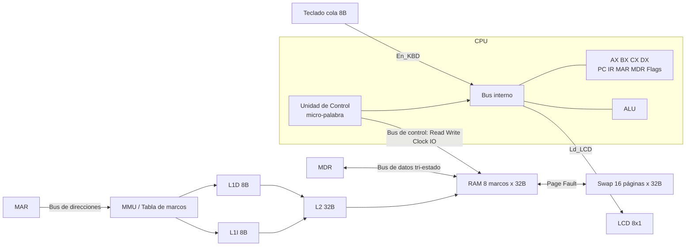

# Plan Parcial 2 — Simulador Avanzado (buses tri-estado, caché, memoria virtual, E/S)

**Equipo:** 3 integrantes · **Plataforma:** Google Sheets + Apps Script (la misma del Parcial 1)
**Plazo:** 8 días → 7 de trabajo + 1 de colchón (Día 8 = solo corregir, ensayar y entregar, sin funciones nuevas).
**Fechas supuestas:** Día 1 = lun 2/11 … Día 7 = dom 8/11 · Día 8 = lun 9/11. **Confirmen con el docente la fecha y hora exactas de cierre.** Después de esa hora no se admite ningún commit ni movimiento en el log de GitHub.
**Nota máxima:** 160 pts = Parte A grupal (100) + Parte B individual (60).

---

## 1. Qué ya tienen del Parcial 1 y qué cambia

| Tema | Parcial 1 (ya hecho) | Parcial 2 (qué agregar) |
|---|---|---|
| Registros | AX, BX + PC, IR, MAR, MDR, REN1/2, ZF/CF/SF | **Agregar CX y DX** |
| ISA | 35 instrucciones de 1–2 bytes | Variantes con CX/DX, **IN reg,[KBD]**, **OUT [LCD],reg** (LOOP opcional) |
| RAM | 256 B planos | **8 marcos de 32 B** (misma capacidad, estructurada) |
| Memoria virtual | no existe | **16 páginas × 32 B = 512 B**, tabla de marcos, Page Fault, swap |
| Caché | no existe | **L1I 8 B, L1D 8 B, L2 32 B**, Hit/Miss, contadores, Hit Rate |
| Buses | `Bus.transfer` implícito | **Buses de control/dirección/datos, buffers tri-estado (High-Z), micro-palabra** |
| E/S | no existe | **Cola de teclado 8 B + LCD 8x1 (buffer 8 B) mapeados en memoria** |
| Software | demo estático + compilador | **Catálogo de 3 programas + editor + cargador** (el compilador de alto nivel ya no se pide: no inviertan tiempo en él) |
| Docs | README en español | **README.md + README_EN.md**, Mermaid, ISA, micro-palabra, enlace a la hoja |
| Equipo | individual | **Nombre y logo del equipo**, repo nuevo, Kanban nuevo, ramas personales |

Lo que se **reutiliza tal cual**: ciclo de 4 fases con micro-operaciones, ALU y banderas, ensamblador de dos pasadas (se adapta), log, resaltado, panel/controles de la hoja, estructura `src/` y pruebas con `EjecutorPruebas`.

---

## 2. Decisiones de diseño (cerradas para que no haya discusiones)

Estas decisiones resuelven huecos del enunciado. Si el docente dice otra cosa, se cambia **una sola vez** en este archivo y en la guía.

- **D-1 Espacio virtual de 9 bits (0x000–0x1FF).** Las páginas 0–7 (virtual 000h–0FFh) son **segmento de código**; las páginas 8–15 (virtual 100h–1FFh) son **segmento de datos**. PC y saltos siguen siendo de 8 bits (dirección virtual de código = PC). Los operandos `[dir]` son de 8 bits y la dirección virtual efectiva de datos es `100h + dir`. Así los registros de 8 bits alcanzan los 512 B.
- **D-2 Traducción:** `VPN = dirVirtual >> 5`, `desplazamiento = dirVirtual & 31`, `dirFísica = PFN*32 + desplazamiento`.
- **D-3 E/S mapeada en memoria dentro de la página 15 (virtual 1E0h–1FFh):** cola de teclado en `1F0h–1F7h` (dir de datos `F0h–F7h`), buffer LCD en `1F8h–1FFh` (dir de datos `F8h–FFh`). La página 15 queda **fija** en un marco (el marco 7), nunca se desaloja y **no pasa por caché**. Quedan 7 marcos para reemplazo.
- **D-4 Orden de acceso a memoria:** CPU → MMU (tabla de marcos) → L1 (I o D) → L2 → RAM. La caché trabaja con **direcciones físicas**.
- **D-5 Caché:** L1I = 1 línea de 8 B (etiqueta = `dirFísica >> 3`). L1D = igual. L2 = 1 bloque de 32 B (etiqueta = `dirFísica >> 5`, se muestra como 4 líneas de 8 B). Política de escritura: **write-through** (escribe en L1D, L2 y RAM; marca Dirty en la tabla de marcos). Si hay Page Fault, se invalida la caché de la página desalojada.
- **D-6 Reemplazo de páginas:** FIFO por defecto, LRU seleccionable con una celda de configuración. La víctima con Dirty = 1 se guarda en la hoja `Swap` antes de ser reemplazada.
- **D-7 Page Fault = reanudar la instrucción:** la UC detecta P = 0, se ejecuta el manejador (micro-operaciones propias en el log) y se **repite la micro-operación que falló**, sin avanzar el PC.
- **D-8 Tri-estado:** en cada micro-paso **como máximo un `En_*` vale 1** sobre el bus de datos interno; todos los demás buffers están en High-Z. La micro-palabra es una tabla de bits por micro-operación y se valida por código.
- **D-9 Contrato único de memoria:** el CPU solo llama a `AccesoMemoria.leer(dirVirtual, tipo)` y `AccesoMemoria.escribir(dirVirtual, valor)` (`tipo` = `'I'` instrucción o `'D'` dato). Detrás de esa función viven MMU → caché → RAM. Nadie más toca la RAM directamente.

---

## 3. Arquitectura objetivo

---

## 4. Reparto de módulos (cada uno defiende uno en la exposición)

| Integrante | Módulo principal | Criterios que cubre | Defiende en vivo |
|---|---|---|---|
| **1 (Adrian)** | Buses, tri-estado, micro-palabra, CX/DX, ISA, identidad, repo y Gitflow | G1, G7, parte de G6, I1–I4 | Buses/Tri-estado + Metodología Gitflow |
| **2** | Memoria virtual, tabla de marcos, Page Fault, swap, cargador | G3, parte de G5 y G6, I1–I4 | Memoria virtual / Page Fault |
| **3** | Caché L1I/L1D/L2, periféricos E/S, catálogo y editor | G2, G4, G5, parte de G6, I1–I4 | Caché + Periféricos E/S |

**Regla de integración:** cada uno trabaja en **sus propios archivos** (listados en la guía) para evitar conflictos de merge. Los puntos de contacto son los contratos de la decisión D-9 y el `Bus`. Integración conjunta al final de los días **3, 5 y 7**.

---

## 5. Tareas por día

Formato de tarjeta (título en inglés, resto en español): `By · For · Reason · Details · Acceptance criteria`. La plantilla está en la guía. Rama: `feature/<nombre>/<modulo>`. Cada tarea = 1 rama + PR con `Closes #N` + revisión de **otro** integrante antes del merge.

### DÍA 1 — Lun 2/11 · Cimientos y contratos

| ID | Dueño | Tarea (título de tarjeta) | Criterio de aceptación clave |
|---|---|---|---|
| 1-1 | Adrian | Create new repository, Kanban board and import Parcial 1 base | Repo nuevo (carpetas `src/`, `docs/`), tablero con Backlog · To Do · In Progress · In Review · Done, las 27 tareas cargadas y asignadas, código del Parcial 1 importado y corriendo |
| 1-2 | Adrian | Define memory access contract and stub modules | `AccesoMemoria.leer/escribir` funcionando como paso directo (sin MMU ni caché), stubs de `MMU`, `Cache` y `Perifericos` con firmas documentadas; los 3 corren el simulador del Parcial 1 sobre el stub |
| 2-1 | Int. 2 | Restructure RAM grid into 8 frames of 32 bytes | Grilla muestra 8 marcos rotulados Marco 0–7 con direcciones físicas en hex y 32 celdas cada uno |
| 3-1 | Int. 3 | Design cache and I/O panels layout in the sheet | Paneles vacíos rotulados para L1I, L1D, L2, contadores, teclado y LCD en la hoja `CPU` o una hoja `Caché`; rangos con nombre definidos |

### DÍA 2 — Mar 3/11 · Módulos aislados con pruebas

| ID | Dueño | Tarea | Criterio de aceptación clave |
|---|---|---|---|
| 1-3 | Adrian | Add CX and DX registers and extend the ISA | CX y DX en `Registros` y en la hoja; MOV/ADD/SUB/INC/DEC/CMP con CX y DX; opcodes nuevos en `ISA.gs` y hoja ISA; pruebas de ALU y ensamblador actualizadas |
| 1-4 | Adrian | Define control word format and tri-state rules | `docs/microword.md` + `MicroPalabra.gs` con la lista exacta de bits `[En_PC, Ld_MAR, Mem_R, ...]` y función `validarUnSoloEmisor(palabra)` con pruebas |
| 2-2 | Int. 2 | Implement virtual memory store and swap sheet | Hoja `Swap` con 16 páginas × 32 B; `leerPagina(vpn)` y `escribirPagina(vpn, bytes)` con pruebas |
| 2-3 | Int. 2 | Build page (frame) table with P, PFN, Dirty and Ref bits | Tabla visible de 16 entradas (VPN, P, PFN, Dirty, Ref) con getters/setters y pruebas |
| 3-2 | Int. 3 | Implement cache engine logic for L1I, L1D and L2 | Funciones puras `buscar`, `rellenar`, etiquetas por D-5, pruebas de hit/miss para cada nivel (aún sin conectar al CPU) |

### DÍA 3 — Mié 4/11 · Núcleo de cada módulo + **primera integración**

| ID | Dueño | Tarea | Criterio de aceptación clave |
|---|---|---|---|
| 1-5 | Adrian | Implement system buses with tri-state buffers | Bus de control (Read/Write/Clock/IO), de direcciones y de datos; distinción interno/externo; `calcularEstadoBuffers(palabra)` devuelve conducción/High-Z de cada componente; error claro si hay 2 emisores |
| 2-4 | Int. 2 | Implement MMU address translation | `MMU.traducir(dirVirtual)` según D-2; muestra VPN, offset, PFN y dirección física en un panel y en el log |
| 2-5 | Int. 2 | Implement page fault handler with restart | Si P = 0: resalta rojo, busca marco libre, copia 32 B desde `Swap`, pone P = 1 y la UC repite la micro-operación (D-7) |
| 3-3 | Int. 3 | Connect cache hierarchy to memory access with Hit/Miss counters | `AccesoMemoria` pasa por MMU → L1 → L2 → RAM; contadores y Hit Rate por nivel; escrituras con write-through |

**Integración del día 3 (final del día, los 3 juntos):** un programa corto lee y escribe pasando por MMU y caché; el log muestra traducción, hit/miss y page fault. Si no funciona, el día 4 arranca arreglando esto.

### DÍA 4 — Jue 5/11 · Reemplazo, micro-palabra en la UC y periféricos

| ID | Dueño | Tarea | Criterio de aceptación clave |
|---|---|---|---|
| 1-6 | Adrian | Refactor control unit to emit control words | Cada micro-operación de búsqueda/decodificación/ejecución/almacenamiento define su micro-palabra; el log la muestra; ninguna micro-operación viola el emisor único |
| 2-6 | Int. 2 | Implement FIFO/LRU replacement with dirty write-back | Cuando no hay marco libre elige víctima (FIFO o LRU por configuración), guarda en `Swap` si Dirty = 1, invalida caché de esa página; bits Ref/Dirty se actualizan |
| 2-7 | Int. 2 | Add page fault animation and fault counters | Entrada de tabla en rojo al fallar, marco destino resaltado, contadores de fallos y desalojos |
| 3-4 | Int. 3 | Add Hit/Miss animation to cache panels | Verde/rojo por nivel en cada acceso, línea cargada resaltada, contadores sincronizados con el log |
| 3-5 | Int. 3 | Implement keyboard queue (8 bytes) with interactive input | Panel donde se escribe un carácter y se encola en `1F0h–1F7h`; cola circular; `En_KBD` en la micro-palabra |
| 3-6 | Int. 3 | Implement LCD 8x1 with 8-byte video buffer | Escritura en `1F8h–1FFh` refresca un display de 8 caracteres; `Ld_LCD` en la micro-palabra |

### DÍA 5 — Vie 6/11 · Programas, E/S en el ciclo y vista de buses · **segunda integración**

| ID | Dueño | Tarea | Criterio de aceptación clave |
|---|---|---|---|
| 1-7 | Adrian | Build bus and tri-state visualization panel | Panel con el bus interno y externo, cada buffer en verde (conduce) o gris (High-Z), bits de la micro-palabra encendidos por paso |
| 1-8 | Adrian | Integrate team identity and controls | Nombre y logo en hoja, README y presentación; controles Step/Run/Pause/Reset funcionando con todos los módulos; leyenda de colores |
| 2-8 | Int. 2 | Adapt assembler and loader to virtual pages | El ensamblador carga código en páginas 0–7 y datos en 8–15 (dir de datos relativa a 100h); errores con número de línea; carga sin fallo de página inicial innecesario |
| 3-7 | Int. 3 | Implement IN and OUT instructions in the full cycle | `IN reg,[KBD]` y `OUT [LCD],reg` en ISA (usar opcodes reservados por Adrian), ensamblador y UC; pasan por bus con señal IO |
| 3-8 | Int. 3 | Create program catalog with 3 required programs | Hoja `Programas` con desplegable: (1) aritmético con bucles usando AX, BX, CX, DX; (2) teclado con eco al LCD; (3) accesos dispersos que provocan Page Faults y fallos de caché |

**Integración del día 5:** los 3 programas del catálogo corren de principio a fin hasta HLT en la hoja real.

### DÍA 6 — Sáb 7/11 · Editor, pruebas y documentación

| ID | Dueño | Tarea | Criterio de aceptación clave |
|---|---|---|---|
| 1-9 | Adrian | Write bilingual README skeleton with Mermaid, ISA and control word spec | `README.md` y `README_EN.md` con diagrama Mermaid, tabla de ISA, especificación de micro-palabra, manual y marcador del enlace a la hoja; cada integrante agrega su sección |
| 2-9 | Int. 2 | Test virtual memory and document it in Spanish and English | Casos de prueba (acceso disperso, desalojo con Dirty, FIFO vs LRU) en `docs/testing.md`; sección bilingüe de memoria virtual |
| 3-9 | Int. 3 | Implement program editor with syntax check and load button | Celdas editables, botón que valida sintaxis y carga a páginas virtuales; el error resalta la línea |
| 3-10 | Int. 3 | Test cache, I/O and catalog programs; document them | Pruebas de L1I/L1D/L2, cola y LCD; sección bilingüe de caché y E/S |

### DÍA 7 — Dom 8/11 · Congelar, ensayar, corregir

| ID | Dueño | Tarea | Criterio de aceptación clave |
|---|---|---|---|
| 1-10 | Adrian | Final integration test, freeze main and verify delivery links | Todas las pruebas pasan en la hoja real; PRs mergeados; tarjetas en Done; enlace de la hoja verificado en ambos README; documento de defensa |
| 2-10 | Int. 2 | Rehearse defense: page fault live edit | Modifica una instrucción o un valor de memoria en vivo y explica cada bit de la tabla de marcos |
| 3-11 | Int. 3 | Rehearse defense: cache and I/O live edit | Cambia un valor y explica el flujo L1→L2→RAM y la cola/LCD |

> Nota: los totales por persona son 10 (Adrian), 10 (Int. 2) y 11 (Int. 3, con las dos tareas de ensayo/prueba livianas). Si sienten que 3 está cargado, pasen **1-2** (contratos) o **3-1** de ida a la persona con menos carga en ese día.

### DÍA 8 — Lun 9/11 · Colchón

Solo corregir errores encontrados, ensayo completo cronometrado (20 min exposición + 10 min preguntas), subir documentación pendiente, y **entregar los enlaces antes del cierre**. Cero funciones nuevas.

---

## 6. Qué hay que mostrar para llegar al máximo (mapa de la rúbrica)

### Parte A — Grupal (100)

| Criterio | Pts | Qué necesita verse en "Excelente" | Tareas |
|---|---|---|---|
| G1 Buses, tri-estado, micro-palabra | 20 | Buses interno/externo, High-Z dinámico, Enable/Load, micro-palabra animada en cada paso | 1-4, 1-5, 1-6, 1-7 |
| G2 Caché L1I/L1D/L2 | 15 | Tamaños exactos (8/8/32), animación del flujo, política de reemplazo, contadores sincronizados | 3-2, 3-3, 3-4 |
| G3 Memoria virtual | 15 | 512 B virtuales, 256 B RAM, tabla interactiva, traducción exacta, animación de Page Fault | 2-1 a 2-7 |
| G4 Periféricos E/S | 15 | Teclado interactivo y LCD 8x1 gobernados por IN/OUT y buffers tri-estado, 8 B en RAM cada uno | 3-5, 3-6, 3-7 |
| G5 Directorio de programas | 15 | Editor, ensamblador y cargador a memoria virtual, 4 registros, flags, 3 programas | 1-3, 2-8, 3-8, 3-9 |
| G6 Documentación bilingüe | 10 | Mermaid completo, micro-palabra, ISA, manual, enlace verificado, inglés cuidado | 1-9, 2-9, 3-10, 1-10 |
| G7 Identidad e interfaz | 10 | Nombre y logo integrados, cables animados, controles Step/Run/Reset | 1-7, 1-8 |

### Parte B — Individual (60 por alumno)

| Criterio | Pts | Cómo asegurarlo |
|---|---|---|
| I1 Kanban | 10 | Cada tarjeta con criterios de aceptación, asignada, movida **cada día** (no al final) |
| I2 Gitflow | 15 | Ramas `feature/<tu-nombre>/<modulo>`, commits atómicos y semánticos, PR con `Closes #N` y revisión cruzada, reparto equitativo en el commit graph |
| I3 Exposición | 15 | Todos uniformados, cada uno ≥ 5 min técnicos, cronometrar 20 min |
| I4 Defensa y código en vivo | 20 | Saber explicar **cada bit** de la micro-palabra y practicar modificar una instrucción o un valor de memoria |

### Riesgos conocidos
1. El código del Parcial 1 se probó en Node, no en Sheets real. **Prueben en la hoja real todos los días** (Ejecutar todas las pruebas).
2. Usen configuración regional "Estados Unidos" en la hoja (hubo un error con REGEXMATCH en español).
3. Apps Script tiene límite de 6 min por ejecución y no puede pausarse: RUN debe usar temporizador del cliente (sidebar) o los controles por casillas ya existentes.
4. Page Fault + caché + bus en la misma micro-operación son lo más propenso a bugs: la integración del día 3 es obligatoria.
5. Si el docente no acepta la decisión D-1 (espacio virtual de 9 bits con segmentos de código y datos), avisen el día 1: afecta ensamblador y MMU.
