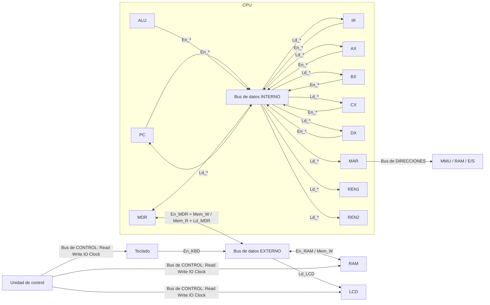

# Buses del sistema y buffers tri-estado (tarea 1-5)

Código: `src/Bus.gs` · Pruebas: `src/pruebas/PruebasBus.gs` (menú *Simulador CPU → Pruebas → Bus*) · Formato de la micro-palabra: `docs/microword.md`.

## 1. Los cuatro buses



| Bus | Conecta | Quién lo maneja | Activo cuando |
|---|---|---|---|
| **Datos interno** | PC, IR, MAR, MDR, AX, BX, CX, DX, REN1, REN2, ALU | el componente con `En_*` = 1 | el emisor es un componente interno (o el MDR sin `Mem_W`) |
| **Datos externo** | MDR, RAM, teclado (KBD), LCD | RAM (`En_RAM`), teclado (`En_KBD`) o MDR (`En_MDR` + `Mem_W`) | hay una lectura o escritura de memoria o E/S |
| **Direcciones** | MAR → MMU → caché / RAM o E/S | MAR (siempre) | `Mem_R` o `Mem_W` = 1; destino E/S si `IO` = 1 |
| **Control** | UC → memoria y E/S | la unidad de control | líneas `Read` (= `Mem_R`), `Write` (= `Mem_W`), `IO`, `Clock` (1 en cada paso) |

El **MDR es el puente**: es el único registro conectado a los dos segmentos del bus de datos. RAM, teclado y LCD hablan con el CPU solo a través del MDR.

## 2. Buffers tri-estado

Cada componente que puede escribir en un bus tiene un buffer de salida: `PC, IR, MDR, AX, BX, CX, DX, ALU, RAM, KBD` (bus de datos) y `MAR` (bus de direcciones).

| Señal | Estado del buffer |
|---|---|
| `En_X = 1` | **CONDUCE**: X pone su valor en el bus (verde en la vista de la tarea 1-7) |
| `En_X = 0` | **HIGH-Z**: X queda desconectado (gris) |
| `Mem_R` o `Mem_W` = 1 | el buffer del **MAR** conduce al bus de direcciones |

`Bus.estadoBuffers(palabra)` devuelve ese mapa para cada micro-paso:

```js
Bus.estadoBuffers(MicroPalabra.crear(['Mem_R', 'En_RAM', 'Ld_MDR']))
// { PC: 'HIGH-Z', IR: 'HIGH-Z', MDR: 'HIGH-Z', AX: 'HIGH-Z', BX: 'HIGH-Z', CX: 'HIGH-Z',
//   DX: 'HIGH-Z', ALU: 'HIGH-Z', RAM: 'CONDUCE', KBD: 'HIGH-Z', MAR: 'CONDUCE' }
```

## 3. Reglas que se validan en cada paso

`Bus.estadoBuses(palabra)` lanza un error con el motivo si la palabra no es físicamente posible:

| # | Regla | Ejemplo rechazado |
|---|---|---|
| 1 | Como máximo **un emisor** (`En_*`) por paso (D-8) | `En_PC + En_AX` → *"Conflicto en el bus de datos: 2 emisores simultáneos (En_PC, En_AX)…"* |
| 2 | Emisor y receptores en el **mismo segmento**; entre segmentos se pasa por el MDR | `En_RAM + Ld_AX` → *"AX está en el bus de datos interno y el emisor RAM en el externo: el dato debe pasar por el MDR"* |
| 3 | `En_RAM` exige `Mem_R` e `IO = 0`; `En_KBD` exige `Mem_R` e `IO = 1` | `En_RAM` sin `Mem_R` |
| 4 | `Mem_R` exige que la RAM o el teclado conduzcan | `Mem_R + Ld_MDR` sin `En_RAM` |
| 5 | `Mem_W` exige que conduzca el MDR; con `IO = 1` el destino es el LCD (`Ld_LCD`) | `En_DX + Ld_LCD` |
| 6 | No se carga de un bus en HIGH-Z, y si alguien conduce, alguien debe cargar | `Ld_AX` solo; `En_AX` solo |

Además se aplican las reglas de `MicroPalabra.validar` (`Mem_R` y `Mem_W` no juntas; `En_X` y `Ld_X` no juntas).

## 4. Estado de los buses en la búsqueda

| Paso | Micro-palabra | Bus activo | Conducen | Direcciones | Control |
|---|---|---|---|---|---|
| `MAR ← PC` | `En_PC Ld_MAR` | interno: PC → MAR | PC | — | Clock |
| `MDR ← RAM[MAR]` | `Mem_R En_RAM Ld_MDR` | externo: RAM → MDR | RAM, MAR | MAR → MEMORIA | Read, Clock |
| `IR ← MDR` | `En_MDR Ld_IR` | interno: MDR → IR | MDR | — | Clock |
| `PC ← PC + 1` | `Inc_PC` | ninguno (HIGH-Z) | — | — | Clock |

Una prueba recorre las micro-operaciones de las **92 instrucciones** y verifica que todas producen un estado de buses válido.

## 5. API

| Función | Devuelve |
|---|---|
| `Bus.estadoBuffers(palabra)` | `{ componente: 'CONDUCE' \| 'HIGH-Z' }` (contrato de la guía) |
| `Bus.estadoBuses(palabra)` | `{ buffers, emisor, receptores, segmento, datosInterno, datosExterno, direcciones, control }` |
| `Bus.describirBuses(estado)` | texto para el log: `"Bus externo: RAM → MDR · Direcciones: MAR → MEMORIA · Conducen: RAM, MAR · resto HIGH-Z"` |
| `Bus.transferir(origen, destino, inmediato, acceso)` | igual que antes; el evento ahora trae `palabra` y `buses` (null para `INM`) |

Constantes: `CONDUCE`, `HIGH_Z`, `SEGMENTO_INTERNO`, `SEGMENTO_EXTERNO`, `BUFFERS_BUS`, `CONEXIONES_BUS`.

## 6. Qué sigue

- **1-6 (hecho):** la unidad de control valida con `Bus.estadoBuses` la micro-palabra de cada paso antes de ejecutarlo; el evento trae `buses` y `descripcionBuses`, y la hoja Log muestra la palabra y sus bits.
- **1-7 (hecho):** panel en la hoja **Buses** (ver sección 7).
- **3-7 (Integrante 3):** IN y OUT usan dos pasos a través del MDR (`docs/microword.md`, sección E/S).

## 7. Panel de buses (tarea 1-7, hoja **Buses**)

Código: `src/VistaBuses.gs` · Pruebas: `src/pruebas/PruebasVistaBuses.gs` (menú *Pruebas → Vista de buses*).

Se actualiza solo en cada micro-paso (`Simulacion` llama a `VistaBuses.actualizar(evento)` después de *Paso*, *Instrucción* o *Hasta HLT*) y vuelve a reposo con *Reiniciar*.

| Sección | Qué muestra |
|---|---|
| Micro-paso / Estado de los buses | `[Paso 03] BÚSQUEDA · IR ← MDR` y el texto de `Bus.describirBuses` |
| Bus de datos interno | emisores PC, IR, MDR, AX, BX, CX, DX, ALU con su buffer; línea del bus; receptores (`Ld_*`) |
| Bus de datos externo | emisores MDR, RAM, KBD; línea del bus; receptores MDR, RAM, LCD |
| Bus de direcciones | buffer del MAR y `MAR (xxh) → MEMORIA` o `→ E/S` |
| Bus de control | Read, Write, IO, Clock (0/1) |
| Micro-palabra | las 30 señales, sus bits, el binario y las señales activas |

| Color | Significado |
|---|---|
| Verde | el buffer **conduce** / el bus lleva un dato en este paso |
| Gris | **HIGH-Z**: buffer desconectado / bus en reposo |
| Ámbar | el componente **carga** el dato (`Ld_*`), la línea de control vale 1 o el bit de la micro-palabra vale 1 |

El MDR aparece en los dos buses de datos: se pinta en verde solo en el segmento por el que conduce en ese paso (interno para `IR ← MDR`, externo para `RAM[MAR] ← MDR`).
